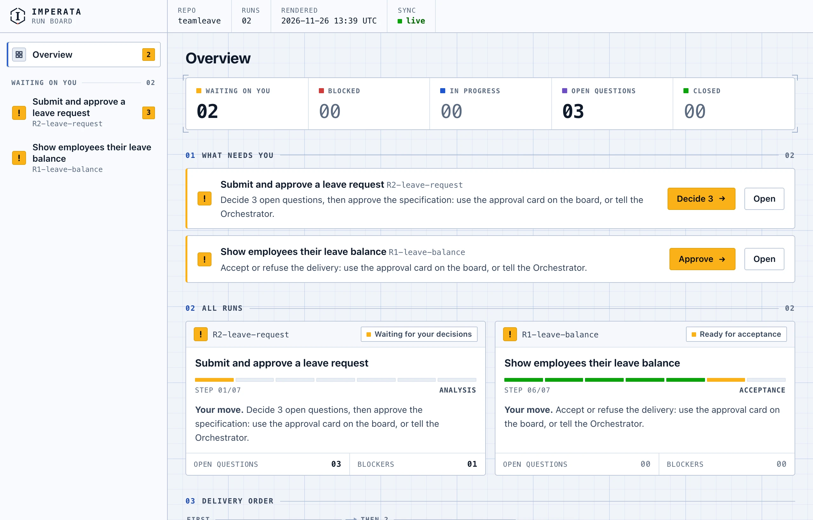
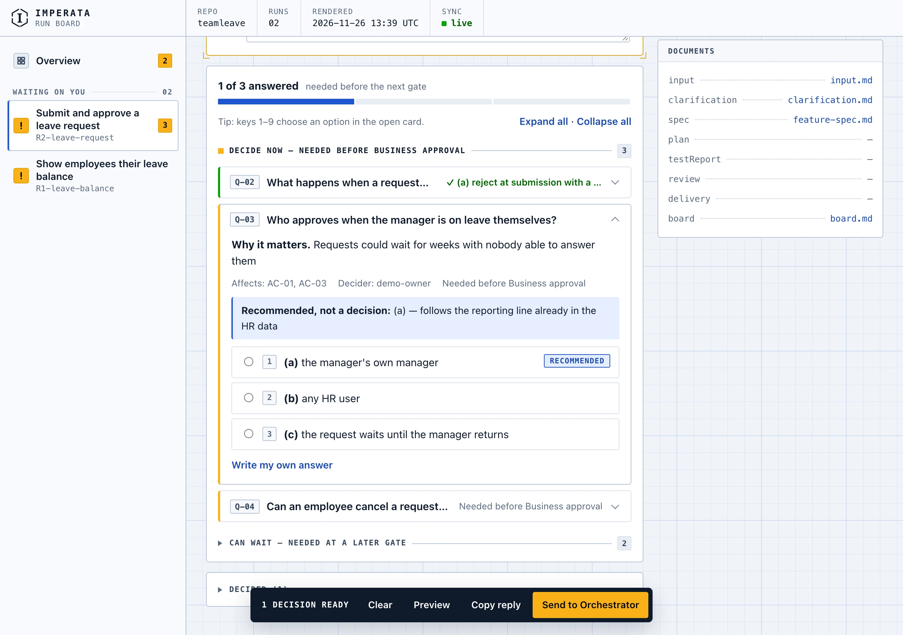

<p align="center">
  <picture>
    <source media="(prefers-color-scheme: dark)" srcset="brand/imperata-logo.svg">
    
  </picture>
</p>

The **Imperata** kit: a supervised, evidence-driven development workflow for **Claude Code** and **GitHub Copilot** that installs into any project repository. An Orchestrator agent takes one requirement at a time through analysis, planning, implementation, independent testing and review. You make the business decisions and approve each gate on a run board; every decision and every piece of evidence stays in the project's repository.

*Imperata* is Latin for "the orders given": the agents carry out what you decide.

**Kit 1.0.0**

<p align="center"></p>


## Quick start

<p align="center"></p>

You need Node 20 or later, git, and Claude Code or VS Code with GitHub Copilot. Clone this repository once, in a folder of its own, at a release:

```bash
git clone --branch v1.0.0 https://github.com/vinhnguyen221b/imperata.git ~/tools/imperata
```

To check that the clone is the published release, built and signed by this repository's release workflow, see [Verify a release](SECURITY.md#verify-a-release).

Then, from your project's root:

```bash
node ~/tools/imperata/imperata-kit.mjs install . --tools claude,copilot
```

`--tools` takes `claude`, `copilot` or both; leave out a tool you do not use, and add `--dry-run` first to see what it would add.

1. Fill in `.orchestra/project.md`: your product, where its sources are, stack rules, and security-sensitive areas.
2. Review what the installer added with `git status`, then commit it.
3. Open the run board in a terminal of your own: `node scripts/board-server.mjs`, then `http://127.0.0.1:4319/sdlc/board.html`.
4. Start a run: in `claude --agent sdlc-orchestrator`, or with the SDLC Orchestrator agent in VS Code, send `/imperata-start` followed by the feature. Each later step has its own command; type `/imperata` to list them.
5. Answer the questions and approve each gate on the board.

The full walk-through, with screenshots, is the **[user guide](USER_GUIDE.md)**.

## What a run looks like

<p align="center"></p>


Your own part of a run is nine moves: five commands, one round of answers and three approvals.


The run board shows what waits on you and every run's progress:

<picture>
  <source media="(prefers-color-scheme: dark)" srcset="docs/images/board-overview-dark.en.webp">
  
</picture>

Questions open one card at a time, with their options, consequences and the analyst's recommendation; nothing is chosen for you:



The screenshots show a synthetic sample product, not a real one.

## Two approval modes: local-record and pull-request

Each run says at its start how you pass its gates, and the Orchestrator asks you which:

- **`local-record`**: you press Approve on the run board, and your decision is saved in the run folder. Nothing is pushed and no pull request is opened. It needs nothing more than the install, and it is the mode for your first runs.
- **`pull-request`**: each of your gates is a pull request on GitHub, and your merge is the approval. The tests gate passes on CI, and GitHub records who merged. It needs a GitHub remote, `gh` signed in, your permission for the Orchestrator to push and open pull requests, and a protected main branch.


The agents do the same work in both modes. Setting up `pull-request` mode is in [section 19 of the user guide](USER_GUIDE.md#19-approval-modes-local-record-and-pull-request); it has had less use than `local-record` (see "Status and boundaries").

## Documentation

<p align="center"></p>

| Read | For |
| --- | --- |
| [USER_GUIDE.md](USER_GUIDE.md) | The words of the kit, installing it, the project profile, stack skills and a team's coding convention, the first run step by step, approval modes, the stages of a run, troubleshooting |
| [KIT_GUIDE.md](KIT_GUIDE.md) | What the installer puts where, who owns each file, updating projects |
| [CLAUDE_CODE_GUIDE.md](starter-claude-code/CLAUDE_CODE_GUIDE.md) | Claude Code: agents, hooks, permission rules, models, auto-run |
| [STARTER_GUIDE.md](starter/STARTER_GUIDE.md) | GitHub Copilot setup, and what never to assume |
| [Blueprint](docs/README.md) | The design: reading order of `docs/01`–`11`, pilot defaults |
| [CHANGELOG.md](CHANGELOG.md) | What each version changes |
| [SECURITY.md](SECURITY.md) | How to report a vulnerability, what the kit guards and its known limits |

## Repository layout

```text
imperata/
├── README.md                      this page
├── CHANGELOG.md, LICENSE, SECURITY.md
├── USER_GUIDE.md, KIT_GUIDE.md
├── CLAUDE.md                      for an agent that works on the kit: the bar and the tests
├── kit.json                       what the installer puts where, for which tool
├── imperata-kit.mjs               install · status · update (Node 20+, no dependencies)
├── .github/workflows/release.yml  publishes a release when a version tag is pushed
├── starter/                       shared parts (schema, templates, validator, board) and the Copilot layer
├── starter-claude-code/           the Claude Code layer (agents, rules, hooks, settings, skills and commands)
├── tests/                         the kit's own tests: node --test tests/*.test.mjs
├── docs/                          the blueprint (01–11) and the images of the guides
└── brand/                         the Imperata symbol, app icon and wordmark
```

## Status and boundaries

This is a blueprint and a starter kit, not a claim of autonomous end-to-end delivery. Both layers have taken feature runs and bug runs from a requirement to `DONE` in `local-record` mode. `pull-request` mode has had less use, and only on the GitHub Copilot layer, where a repair and a design brief have not been run yet. The kit holds no accounts, credentials, Jira site or Figma workspace.

Keep this repository apart from the projects that receive the kit. Do not copy it into a project, and do not add product documents here: each project describes its product in its own `.orchestra/project.md`.

## License

[MIT](LICENSE).
