# Imperata — User guide

**Kit version:** 1.0.0 · **Date:** 2026-11-27

This guide takes you from an empty project repository to a delivery you have accepted: installing the kit, describing your product, your first run step by step, and what to do when something does not go as described. It is the "how to use it" companion to the blueprint documents in [`docs/`](docs/), which explain why Imperata is built this way.

> **Status.** Imperata is a blueprint and a starter kit, not a proven autonomous delivery system. [Section 27](#27-how-far-this-has-been-tried) says how far each part has been tried. The screenshots come from a **synthetic** sample product ("TeamLeave"), made only to illustrate the board.

<p align="center">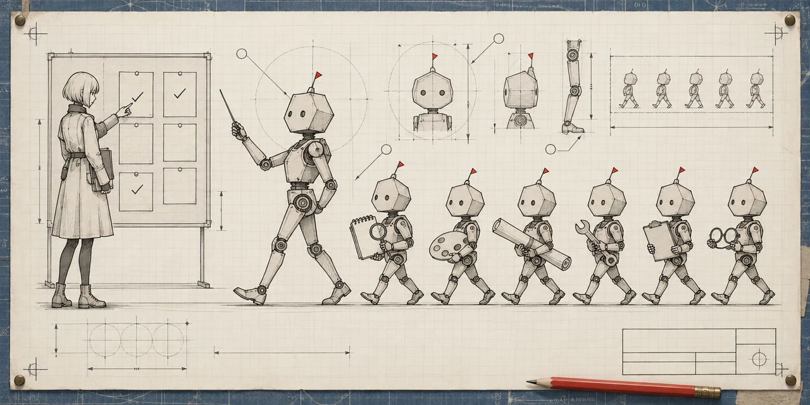</p>

## How to read this guide

| Part | Sections | Read it |
| --- | --- | --- |
| 1. Understand it | 1 to 3 | First: what Imperata is, the words it uses, and one run at a glance |
| 2. Set it up | 4 to 9 | Once for each project |
| 3. Your first run | 10 to 16 | Step by step: what you send, what happens, what you get, what you decide |
| 4. Other ways to run | 17 to 21 | A small change, a bug, pull requests, auto-run, Claude Code or Copilot |
| 5. Reference | 22 to 30 | Stages, files, checks, commands, troubleshooting |

In a hurry: read section 3, then do sections 4 to 10.

## Contents

**Part 1: understand it**

1. [What Imperata is](#1-what-imperata-is)
2. [The words this guide uses](#2-the-words-this-guide-uses)
3. [One run at a glance](#3-one-run-at-a-glance)

**Part 2: set it up**

4. [Before you start](#4-before-you-start)
5. [Install the kit into a project](#5-install-the-kit-into-a-project)
6. [Describe your product: the project profile](#6-describe-your-product-the-project-profile)
7. [Give the agents your conventions: stack skills](#7-give-the-agents-your-conventions-stack-skills)
8. [Check the setup](#8-check-the-setup)
9. [Open the run board](#9-open-the-run-board)

**Part 3: your first run**

10. [Step 1: start the run](#10-step-1-start-the-run)
11. [Step 2: answer the questions](#11-step-2-answer-the-questions)
12. [Step 3: approve the specification](#12-step-3-approve-the-specification)
13. [Step 4: plan, and approve the plan](#13-step-4-plan-and-approve-the-plan)
14. [Step 5: build, one task at a time](#14-step-5-build-one-task-at-a-time)
15. [Step 6: verify](#15-step-6-verify)
16. [Step 7: accept the delivery and merge](#16-step-7-accept-the-delivery-and-merge)

**Part 4: other ways to run**

17. [The light track for small changes](#17-the-light-track-for-small-changes)
18. [Fixing a bug](#18-fixing-a-bug)
19. [Approval modes: local-record and pull-request](#19-approval-modes-local-record-and-pull-request)
20. [Auto-run: the Orchestrator continues after each Send](#20-auto-run-the-orchestrator-continues-after-each-send)
21. [Claude Code or GitHub Copilot](#21-claude-code-or-github-copilot)

**Part 5: reference**

22. [Stages of a run, and whose move it is](#22-stages-of-a-run-and-whose-move-it-is)
23. [Inside a run folder](#23-inside-a-run-folder)
24. [What the gate check holds a run to](#24-what-the-gate-check-holds-a-run-to)
25. [Update the kit](#25-update-the-kit)
26. [Troubleshooting](#26-troubleshooting)
27. [How far this has been tried](#27-how-far-this-has-been-tried)
28. [Questions people ask](#28-questions-people-ask)
29. [Command reference](#29-command-reference)
30. [Where to read more](#30-where-to-read-more)

---

## Part 1: understand it

<p align="center">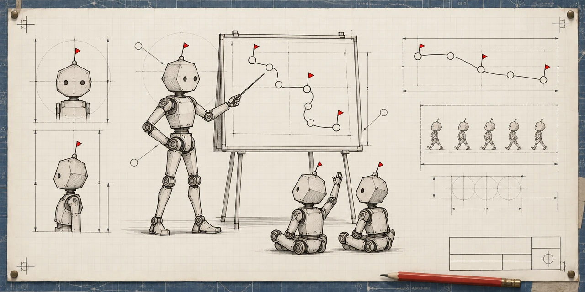</p>

### 1. What Imperata is


**Imperata** is a supervised development workflow for Claude Code and GitHub Copilot. You give it one bounded requirement at a time (a **run**). An **Orchestrator** agent takes the run through analysis, planning, implementation, independent testing and review, delegating each step to a specialist. It stops whenever a business decision or an approval is needed, and it keeps every decision and every piece of evidence as files in your repository.

| Agent | What it does | Writes | Default model (Claude Code) |
| --- | --- | --- | --- |
| **Orchestrator** (`sdlc-orchestrator`) | Runs the run: delegates, records decisions, checks every gate, reports | `run.json`, `input.md`, `clarification.md`, and the specification, design brief, plan and review from the specialists' drafts, `delivery.md` | `sonnet` |
| **Business Analyst** | Drafts the specification and lists the decisions the sources leave open | nothing; returns drafts (read-only) | `sonnet` |
| **UX Designer** | Flows, screen states, accessibility, only for features that change the UI | nothing; returns a design brief (read-only) | `sonnet` |
| **Architect** | Technical plan, decisions, tasks with a `Complexity` and the `Skills` each needs | nothing; returns the plan (read-only) | `opus` |
| **Developer** | Implements one approved task at a time and runs targeted tests | code and tests | `sonnet`, or per task |
| **QA Engineer** | Independent test matrix from the acceptance criteria; runs real tests | test files and the run folder only | `sonnet`, or per task |
| **Code Reviewer** | Independent review of the diff; findings by severity | nothing; read-only, no shell | `opus` |

Three ideas carry the whole kit:

- **You decide, agents propose.** A business question is never answered by an agent's guess. A gate that is yours passes only on your decision.
- **Evidence, not narrative.** A test gate passes on real exit codes or a CI run, never on an agent saying "all tests pass". `SKIPPED`, `NOT_RUN` and `UNKNOWN` are not `PASSED`.
- **Everything is a file in git.** The run's state (`run.json`), the questions, the specification, the plan, the test report, the review and your decisions live in `sdlc/runs/<runId>/`. The run board is drawn from those files; it decides nothing itself.

The kit names no product. Each project describes its own product in `.orchestra/project.md`.

### 2. The words this guide uses

| Word | What it means here |
| --- | --- |
| **Owner** | You: the person who decides the business questions and passes the three human gates |
| **Run** | One bounded requirement, a feature or a bug fix, taken from analysis to delivery. It has an ID (`runId`) and a folder, `sdlc/runs/<runId>/` |
| **Orchestrator** | The agent that drives a run as your main session. It is the only one you talk to |
| **Specialist** | One of the six agents the Orchestrator delegates to. A specialist never delegates further and never approves its own work |
| **Project profile** | `.orchestra/project.md`: your product, its sources, its rules and its security-sensitive areas. Every agent reads it first |
| **Sources** | Your product documents: requirements, business rules, backlog. The Business Analyst analyses from them |
| **Specification** | `feature-spec.md`: the business rules, the assumptions and the acceptance criteria of a run |
| **Acceptance criterion** | One behaviour a test can decide: one thing a person does, and what can be observed of its result. The values it holds for are its **cases** |
| **Question** | A point the sources leave open and no reasonable default settles. Only you can close it. It is kept in `clarification.md` |
| **Assumption** | A point the sources leave open where a default is reasonable. It is written in the specification, and you approve it with the specification |
| **Technical plan** | `technical-plan.md`: the Architect's decisions and the tasks |
| **Task** | One piece of the plan, built and tested on its own. It has a `Complexity` (`low`, `standard`, `high`), which chooses the model, a `Skills` field and an `Owner check` |
| **Stack skill** | The conventions and commands of one stack of your repository, in a file the agents read for each task (section 7) |
| **Gate** | A check a run must pass before it moves on. There are six. Three are yours (**human gates**): `businessApproval`, `planApproval` and `humanAcceptance`. Three rest on evidence: `implementation`, `tests` and `review` |
| **Stage** | Where a run stands, such as `AWAITING_BUSINESS_DECISION` or `IMPLEMENTING` (section 22) |
| **Track** | `full`, with all three approvals, or `light`, without a separate plan approval, for a small low-risk change (section 17) |
| **Approval mode** | How a human gate is passed: by your decision recorded in the run folder (`local-record`), or by your merge of a pull request (`pull-request`) (section 19) |
| **Run board** | A page drawn from the run files: what waits on you, the questions, the approvals, the tasks and the checks (section 9) |
| **Gate check** | `scripts/validate-gates.mjs`: the script that accepts or rejects a run's state. The Orchestrator runs it before every change of stage |
| **Test lock** | The list of a run's test files with their fingerprints. After QA, only the QA Engineer changes a locked test |
| **Calibration** | The check that each test of a run passes with the run's change and fails without it |
| **Finding** | A defect the Code Reviewer reports, rated `BLOCKER`, `MAJOR` or `MINOR` |
| **Delivery dossier** | `delivery.md`: what was built, the traceability from criterion to task to test, the model of each task, and what is proven and what is not |

### 3. One run at a glance

A run has seven steps and six gates. Three of the gates are yours:


Your own part is nine moves: five commands, one round of answers and three approvals.


Three rules hold for every run:

- **One tool for a run.** Drive a run with Claude Code or with Copilot from start to finish, not with both.
- **A new session for each command after the first.** Start a new Orchestrator session for `/imperata-plan`, `/imperata-implement`, `/imperata-verify`, `/imperata-merge` and `/imperata-close`. Section 13 says why.
- **The board tells you what is next.** When a run waits on you, the board says "Your move" and gives the command for the next step with the run's ID filled in.

#### The commands

Each step that you start in a session has a command. Type `/imperata` to list them, each with a line that says when to use it. A command sends the Orchestrator the same instructions each time, so you give only what changes: the feature, the bug report or the run's ID.

| Command | When | After the command |
| --- | --- | --- |
| `/imperata-start` | A new run | The feature |
| `/imperata-bug` | A bug to fix, in an interactive session | What happens, what should happen, how to reproduce it, where it was seen |
| `/imperata-plan` | The specification is approved, for example once its pull request is merged | The run's ID |
| `/imperata-implement` | The plan is approved; again after you checked a task, for the next one | The run's ID |
| `/imperata-verify` | Every task is built: it is your word for the last one, then the whole suite, the calibration and the review; also a repair after you answered review findings | The run's ID |
| `/imperata-merge` | `local-record` mode, after you accepted the delivery | The run's ID, and the branch when it is not the main one |
| `/imperata-close` | `pull-request` mode, after you merged the delivery pull request | The run's ID |
| `/imperata-preflight` | Before the first run; in Claude Code, in a plain `claude` session | Nothing |

Send every command but the preflight in an SDLC Orchestrator session. Sent in another session, a command does nothing but say how to start one. No agent can run a command by itself, so the instruction to merge in `/imperata-merge` is always yours.

---

## Part 2: set it up

<p align="center">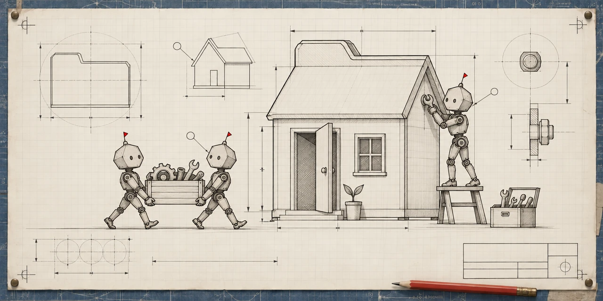</p>

### 4. Before you start

| You need | Check with |
| --- | --- |
| Node.js 20 or later | `node --version` |
| git | `git --version` |
| Claude Code, **or** VS Code with GitHub Copilot (Copilot harness) | `claude --version`, or the Copilot chat panel in VS Code |
| A project repository you are allowed to use with AI tools | Start with a disposable repository of your own, with no code or data you may not share with an AI service |
| Optional, for `pull-request` mode: a GitHub remote and the `gh` CLI signed in | `gh auth status` |

Get the kit once per machine, in a folder of its own, at a release:

```bash
git clone --branch v1.0.0 https://github.com/vinhnguyen221b/imperata.git ~/tools/imperata
```

`--branch v1.0.0` takes that release, not whatever `main` holds the day you clone; section 25 moves to a later one. Clone rather than download a ZIP: the installer uses the git history of the kit to recognise older kit files when it updates a project, and records the commit it installed from.

### 5. Install the kit into a project


From your project's root, preview first, then install:

```bash
node ~/tools/imperata/imperata-kit.mjs install . --tools claude --dry-run
```

```bash
node ~/tools/imperata/imperata-kit.mjs install . --tools claude
```

- `--tools` is `claude`, `copilot` or `claude,copilot` (the default is both). A tool you leave out gets none of its files. Run `install` again with another tool to add it later: the tools already installed stay.
- `--profile <file>` starts `.orchestra/project.md` from an existing profile, for example the one of another repository of the same product.
- The installer never commits. Read what it added with `git status` and `git diff`, then commit it yourself.

The installer lists every file it adds and ends with your next steps. For example, with both tools:

```text
imperata 1.0.0 → /path/to/teamleave
tools: claude, copilot   kit commit: 1a2b3c4

added (70)
  .orchestra/schemas/run.schema.json
  .orchestra/templates/clarification.template.md
  …
  .orchestra/project.md  — template: fill it in
  …
Next:
  1. Fill in .orchestra/project.md: the product, its sources, stack rules and security-sensitive areas.
  2. Review the changes with git and commit them.
  3. node scripts/validate-gates.mjs .orchestra/runs/EXAMPLE.run.json
  4. node scripts/board-server.mjs   (board at http://127.0.0.1:4319/sdlc/board.html)
  5. Start a run: in "claude --agent sdlc-orchestrator" or the SDLC Orchestrator agent in VS Code, send /imperata-start <feature>.
     Each later step has a command too: type /imperata to list them.
  The steps of .orchestra/STARTER_GUIDE.md that set up approval modes, CI and stack skills still apply.
```

What you now have in the project:

| Folder | Holds | Whose |
| --- | --- | --- |
| `.claude/` (Claude Code) or `.github/` (Copilot) | The seven agents, the commands, the kit's two skills, and for Claude Code the hooks and permission rules | The kit's; your own stack skills there are yours |
| `.orchestra/` | The project profile, the templates of every run file, the manifest schema, the rules for tests | The kit's, but for `project.md` and `auto-run.json`, which are yours |
| `scripts/` | The gate check, the board renderer and its server, the test lock, the script that records a change to a run | The kit's |
| `sdlc/runs/` | One folder for each run. It appears with your first run | Yours, committed with the run |

What lands where in full, and who owns it afterwards, is in [`KIT_GUIDE.md`](KIT_GUIDE.md#what-lands-where). In short: kit files are replaced on update unless you changed them; your files (`.orchestra/project.md`, `CLAUDE.md`, `.claude/settings.json`, `.gitignore`) are never overwritten, only completed with missing lines; a `.claude/settings.json` key of another kind than the kit's is reported as a conflict and left for you (or `--force`).

**Put your product sources in the project**, for example a `docs/` folder with requirements, business rules and a backlog, and a `README.md` that gives their reading order. The Business Analyst analyses from these.

### 6. Describe your product: the project profile

Every agent reads `.orchestra/project.md` before doing anything. The kit creates it once from a template and never touches it again. Replace each `<…>` and delete lines that do not apply. A short, realistic example:

```markdown
## Product

- **Name:** TeamLeave
- **Sources and reading order:** `docs/`, reading order in `README.md`
- **Version of the sources:** 1.0
- **Tracker:** local tickets only

## Architecture and stack rules

- Node API with a domain module; React web client
- business invariants live in server-side domain functions

## Security-sensitive areas

- an employee reads and changes only their own requests and balance

## Business Analyst: questions to raise for this product

- who approves, and what happens when the approver is away
```

What each section does:

| Section | Effect |
| --- | --- |
| Product, sources, version, tracker | Where the Business Analyst reads; the version is copied into each run as `productDocVersion` |
| Architecture and stack rules | The Architect plans within them; the Code Reviewer checks them |
| Security-sensitive areas | A task that touches one is `Complexity: high` (strongest model), the plan says how it proves the area holds, QA covers it, every review checks it |
| Test file locations | Where the QA Engineer may write beyond the usual conventions; in Claude Code a hook blocks other writes |
| Questions, QA areas, review areas, Architect defaults | Product-specific reminders for each specialist |

How to write it well:

- **Say how your sources mark what is decided.** The status legend ("Confirmed", "Open", or whatever your documents use) tells the Business Analyst what it may build on and what it must ask you.
- **Write a security-sensitive area as what must hold**, not as a topic: "an employee reads and changes only their own requests", rather than "authorization". The plan then has something to prove and QA something to test.
- **Keep it short.** Every agent reads the whole profile in every session. A rule for one stack belongs in that stack's skill (section 7), not here.
- **A second repository of the same product** starts from the first one's profile: pass it with `--profile` at install.

### 7. Give the agents your conventions: stack skills

A **stack skill** holds the conventions and the commands of one stack of your repository, such as "Node API" or "React web client". It is where a rule about how code is written reaches the agents, task by task.


#### What a stack skill is

A folder with a `SKILL.md`, written from the template in `.orchestra/templates/stack-skill/`:

| Tool | Folder |
| --- | --- |
| Claude Code | `.claude/skills/<stack-name>/` |
| Copilot | `.github/skills/<stack-name>/` |

`SKILL.md` has five parts:

| Part | Holds |
| --- | --- |
| Where things live | The source layout, where tests go, the shared contracts |
| Conventions | Each as one sentence a reviewer can check |
| Commands | Lint, unit tests, one test file, all tests, and what a fresh checkout needs before tests can run |
| Review points for this stack | What every review checks, the security rules first |
| References | Longer files under `references/`, each with when to read it |

Keep `SKILL.md` short: it is read for every task on that stack. Put the depth under `references/`.

#### Who reads it, and how a rule is held

| Who | What it does with the skill |
| --- | --- |
| Business Analyst | Takes a rule as decided. Where one bears on the feature, the specification holds it as an approved constraint and does not ask you about it. Where a rule and a confirmed rule of your sources cannot both hold, it asks you |
| Architect | Names, in the `Skills` field of every task, the skill the task needs, and a reference file only when the task depends on it |
| Developer, QA Engineer | Read the files the task names, and no others. The Developer returns, for each file, the rule that shaped the code, quoted word for word |
| Gate check | Looks every quote of the "Skills applied" table up in the file its row names. A rule nobody read cannot be claimed |
| Code Reviewer | Checks the patch against the review points, and each quoted rule against the code |

The gate check shows that a rule was read and quoted. Whether the code follows it is for the Code Reviewer and for you.

#### Getting your first stack skill

There are two ways.

**Let the first plan write it.** When no skill exists for a stack the plan needs, the Architect makes the first task `TASK-00 — Stack skill <stack>`. It writes the skill from your architecture and stack rules, your sources and the code that exists.

- You approve its conventions with the plan. A convention your sources do not state is listed in the plan's Decisions table as a proposal, never as a fact.
- In Claude Code, the Developer's write under `.claude/skills/` waits for your approval in the session. No permission rule can grant it in advance, and the kit's settings ask for every write under `.claude/` made with the file tools, in auto mode as well, so in a session nobody watches such a write is denied. The rule does not hold a shell command that writes under `.claude/`; git shows such a change.
- If the profile and the sources name no stack, the Architect asks you instead of choosing.

**Write it yourself, before the first run.** Copy `.orchestra/templates/stack-skill/` to the skills folder of your tool, rename `SKILL.template.md` to `SKILL.md` and fill it in. Do this when the conventions already exist, as a team's coding convention does. Create a skill only for a stack that is in the repository.

#### Bringing in your team's coding convention

A team often keeps a coding convention for each language or framework, with rule numbers of its own. To make the agents follow one:

1. **Create the stack skill folder** for the stack the convention is about, as above.
2. **Put the convention's document in `references/`, unchanged.** Keep its version and date at the top. Split a long document by topic, one file each, so that a task loads only what it needs.
3. **Write its rules into `SKILL.md`, one sentence each, in the document's own words and under its own numbers.** A rule the agents quote is then the convention's own rule, and a review finding can name its number:

   ```markdown
   ## Conventions

   - **JS-03** — A module has named exports only; `export default` is not used.
   - **JS-12** — Code throws only `AppError` from `src/errors.mjs`, with a code from `ERROR_CODES`.
   ```
4. **Put the security rules under "Review points for this stack".** Every review then checks them.
5. **Leave to the linter what a linter can check**, and give its command in the Commands table. The Developer runs it for each task.
6. **Say in the project profile that the convention holds, and where it is.** Name each security-sensitive area with the rules that guard it, and tell the Code Reviewer to name the rule's number in a finding:

   ```markdown
   ## Architecture and stack rules

   - The team's coding convention, version 3.2, holds for all code and all tests. It is in the stack skill `node-api`.

   ## Code Reviewer: areas to check

   - every rule under "Review points for this stack" of the stack skill; a finding names the number of the rule
   ```
7. **Commit**, then start your first run. With a skill in place, the plan needs no `TASK-00`.

What to expect afterwards:

- **A rule of the convention is not asked about.** The specification holds it as an approved constraint that names the skill file and the rule.
- **Where your sources and the convention disagree, you are told.** For example a ticket gives a file's first line without quotes and the convention quotes every cell. The Business Analyst asks you which holds. If your profile says that the convention is decided, the specification follows the convention instead and says, as an assumption you approve, how it differs from the ticket.
- **When the convention has a new version**, replace the document and bring `SKILL.md` in line with it in the same commit.
- **With both tools**, the skill exists twice, under `.claude/skills/` and `.github/skills/`. Change both copies in the same commit.
- **An update of the kit never touches a stack skill.** It is yours.

A rule that is written in neither a stack skill nor the profile reaches nobody. A convention's document brought in this way has not been tried past the specification of a run.

### 8. Check the setup

1. **Validator.** From the project root:

   ```bash
   node scripts/validate-gates.mjs .orchestra/runs/EXAMPLE.run.json
   ```

   It should print `Manifest accepted for EXAMPLE in stage ANALYSIS`, followed by a `WARNING: manifest only…` line: without `--verify-remote` the validator reads the manifest alone, which is expected here. This only proves the tooling works; it says nothing about delivery.
2. **Commit** the kit: `git add -A && git commit -m "Install the Imperata kit"`.
3. **Claude Code.** Open the project in VS Code, start `claude` in the integrated terminal and trust the folder when asked (hooks run only in a trusted folder). Run `/agents` (seven agents), `/hooks` and `/permissions` (the kit's hooks and rules from `.claude/settings.json`), and type `/imperata` (eight commands).
4. **Test the hooks on purpose** before the first real run (details in step 8 of [`CLAUDE_CODE_GUIDE.md`](starter-claude-code/CLAUDE_CODE_GUIDE.md#install)):
   - Start `claude --agent sdlc-orchestrator` and ask it to have `qa-engineer` create `src/hook-test.ts`. The edit must be refused with "QA Engineer write blocked".
   - Copy the sample manifest to `sdlc/runs/HOOKTEST/run.json` and ask the Orchestrator to set `currentStage` to `READY_FOR_IMPLEMENTATION` with its file edit tool, not with `scripts/record-run.mjs`: the hooks see only the file tools. The session must receive "Gate validator rejected". Delete the folder afterwards.
5. **Copilot.** Select the **Copilot harness** in VS Code and check in Agent Customizations that `SDLC Orchestrator` and the six specialists are listed, and that typing `/imperata` in the chat lists eight commands. Replace the `model` identifiers in `.github/agents/*.agent.md` with ones your plan offers (step 2 of `.orchestra/STARTER_GUIDE.md`).
6. Optional: run the read-only capability preflight, `/imperata-preflight`: in a plain `claude` session, not the Orchestrator (Claude Code), or in the chat (Copilot).

You are set up when the validator accepts the sample, the agents and the eight commands are listed, and, in Claude Code, both hook tests refuse.

### 9. Open the run board

In a terminal of your own, from the project root:

```bash
node scripts/board-server.mjs
```

Open `http://127.0.0.1:4319/sdlc/board.html`. Before the first run the page is empty. During a run it refreshes by itself whenever a run file changes.

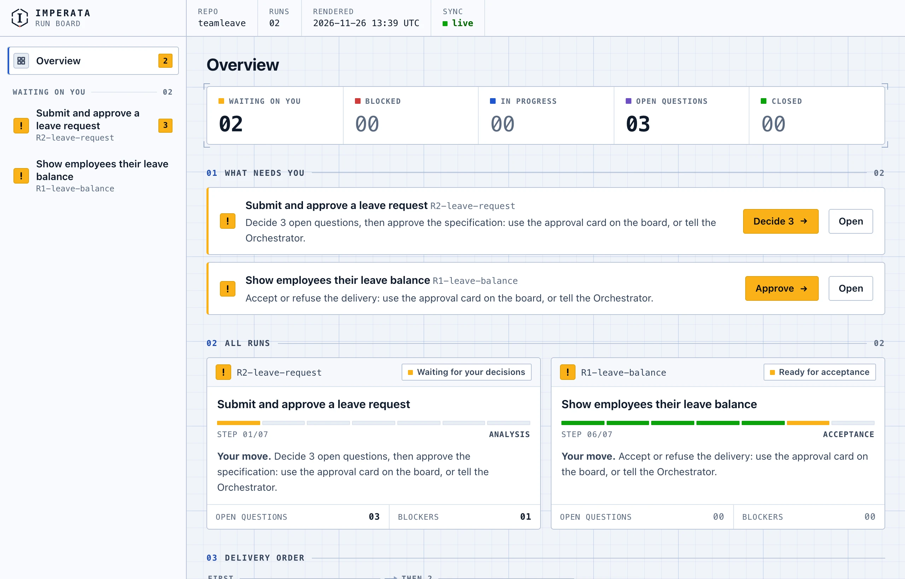

The **overview** answers "what do I have to do now?":

- **Counters**: runs waiting on you, blocked, in progress, open questions, closed.
- **What needs you**: one row per run that waits on you, with a button that goes straight to the decision ("Decide 3", "Approve").
- **All runs**: each run with its stage, a progress bar of its gates and its next move.
- **Delivery order**: runs that depend on other runs (`dependsOn` in `run.json`).

The page has a dark theme that follows your system, and a phone layout.

<p align="center">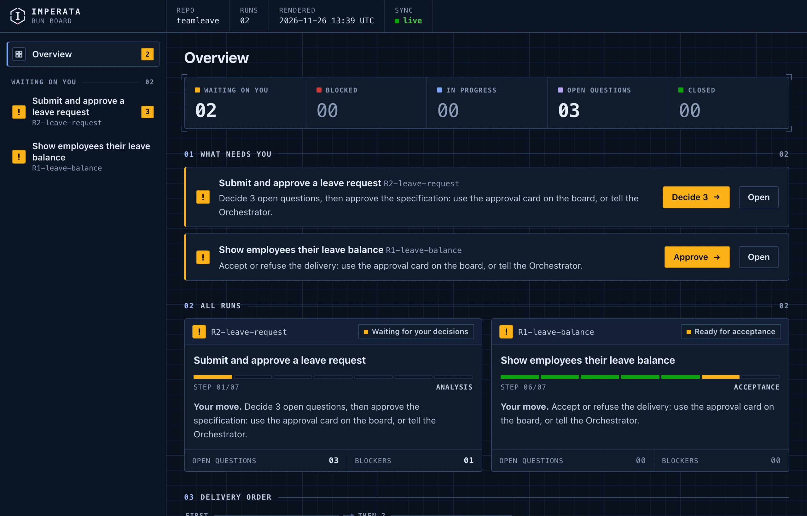 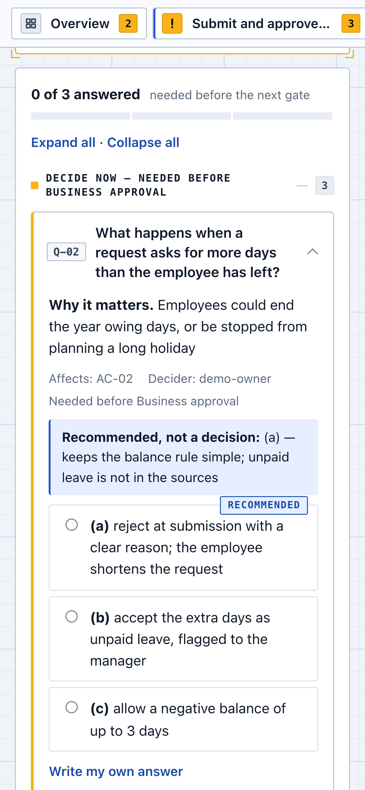</p>

No server? `node scripts/render-run-board.mjs` writes `sdlc/board.html`, which you can open as a file. Everything works except the Send button: use **Copy reply** and paste the reply into the Orchestrator session instead.

---

## Part 3: your first run

<p align="center">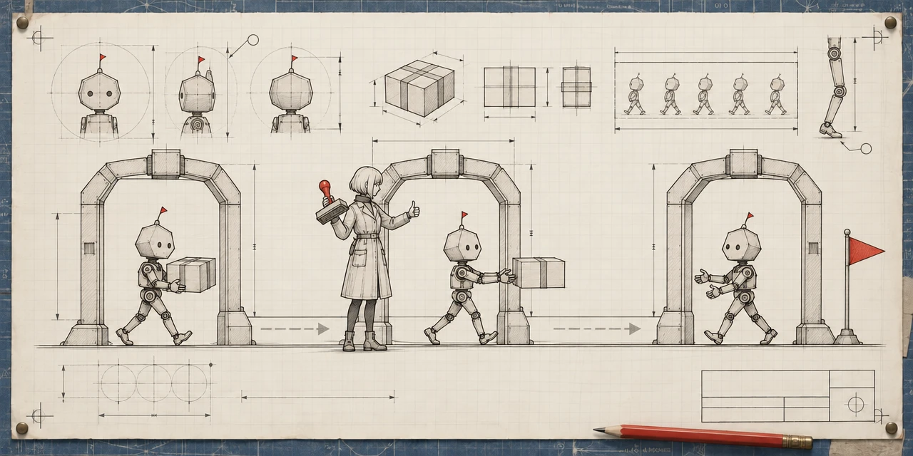</p>

The seven steps below follow one run from the requirement to `DONE`, on the full track and in `local-record` mode. Each says what you do, what happens, what you get and what comes next.

### 10. Step 1: start the run

Pick **one small, bounded feature** whose sources leave at least one business rule open, so the Business Analyst has to ask instead of invent ([`docs/01_EXECUTIVE_BLUEPRINT.md`](docs/01_EXECUTIVE_BLUEPRINT.md#choosing-a-feature-that-challenges-imperata) has the criteria). On a repository without code, the first run is usually a foundation run.

**You do.** Start an Orchestrator session and send the start command with the feature after it.

- Claude Code, in the VS Code integrated terminal:

  ```bash
  claude --agent sdlc-orchestrator
  ```

  then:

  ```text
  /imperata-start Members can reset their password by email
  ```
- Copilot: select the SDLC Orchestrator agent and send the same command.

The feature can be a sentence, or a ticket of your sources: `/imperata-start` followed by the ticket's ID and title.

**What happens.**

1. The Orchestrator asks which approval mode the run uses. For the first run, answer **`local-record`**. You may also give it with the command, in the same message.
2. It reads the project profile and the sources, creates the run folder and delegates to the Business Analyst.
3. The Business Analyst drafts the specification. What your sources leave open becomes a question, or, where a default is reasonable, an assumption.
4. For a small, low-risk change the Orchestrator may propose the light track (section 17). If you say nothing, the run is on the full track.
5. The Orchestrator saves the draft, records the run and stops.

**You get.**

- `sdlc/runs/<runId>/input.md`, `run.json`, a draft `feature-spec.md` and `clarification.md` with the open questions;
- the stage `AWAITING_BUSINESS_DECISION`, and "Your move" on the board;
- a report that ends with a decision brief:

  ```text
  Decisions needed before businessApproval — <runId>
  1. Q-02 — <the question in one line>
     (a) <option> → <consequence>
     (b) <option> → <consequence>
  ```

**Next:** answer the questions.

### 11. Step 2: answer the questions


**You do.** Open the run from the board's overview, tab **Decisions**, and answer each card.

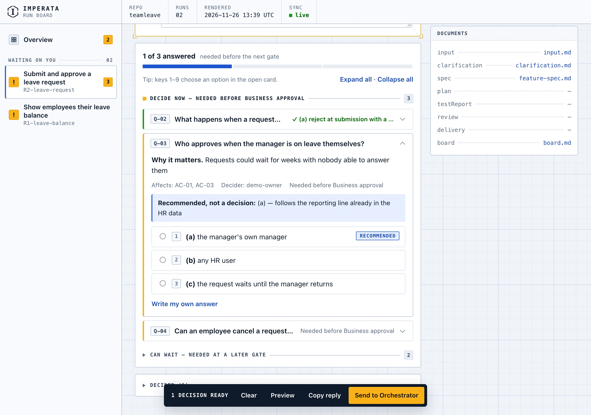

- Each question is a **card**: why it matters, what it affects, the options with their consequences, and the Business Analyst's recommendation, labelled "Recommended, not a decision". Nothing is pre-selected.
- Choose an option with a click or the keys **1–9**, or **Write my own answer**. The card closes and the next unanswered one opens. The meter counts the answers needed before the next gate.
- Questions are grouped by the gate they block: **Decide now** and **Can wait** (folded).
- **Preview** shows the exact reply; **Send to Orchestrator** saves it, verbatim, as `sdlc/runs/<runId>/decisions/<time>.md`.

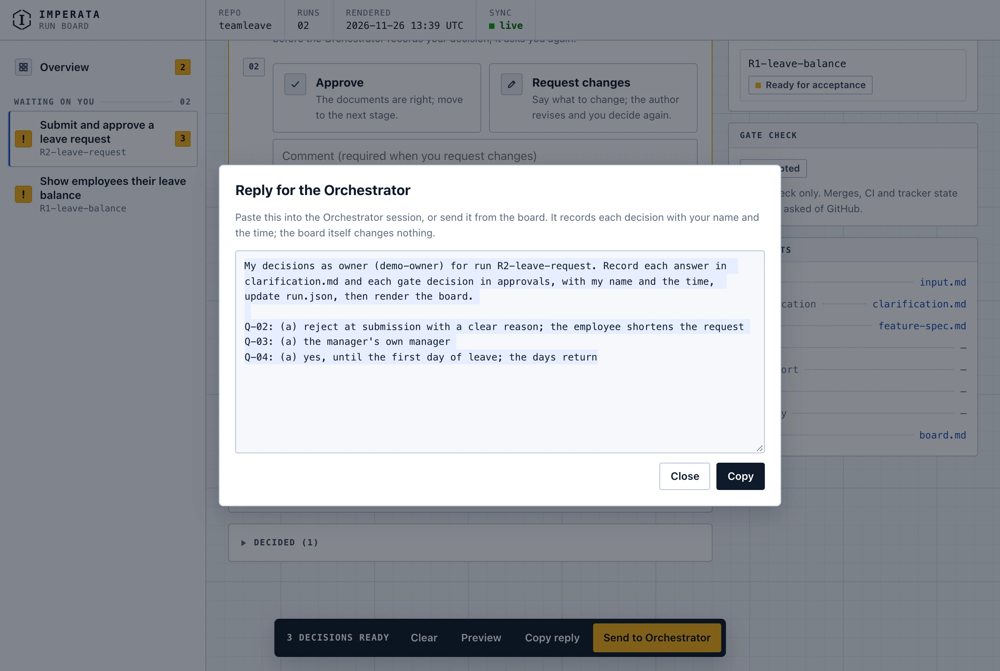

Then tell the Orchestrator **"decisions sent"**. You can also answer in its session, in your own words.

**What happens.** The Orchestrator records each decision in `clarification.md` with your name, the time and the decision file as evidence, updates `run.json` and renders the board again. Where your answers call for it, the Business Analyst completes the specification: a criterion that waited on a question is written once you have decided. No agent may write in `decisions/` (in Claude Code a hook enforces this for the file tools).

**How many questions to expect.**

- You get at most **five questions** before one gate at a time. The Business Analyst asks only what a reasonable default does not settle, keeps the five whose answers change the most, and asks the rest in the next round, where your answers may have settled them.
- Where a default is reasonable, it does not ask: it writes the default under **Assumptions** in the specification.
- A point in a security-sensitive area that no default settles is a question even past five, never an assumption to stay under the limit: up to **ten** questions in all, each one past five in such an area. If more are open, "Check before you decide" says so.
- A rule of a stack skill is not asked about (section 7).

**You get.** A specification with no open question before the business approval, and an approval card on the board.

**Next:** approve the specification.

### 12. Step 3: approve the specification

This is the first of your three gates, `businessApproval`. Approving it says: these business rules, these assumptions and these acceptance criteria are what I want built.

**You do.** Read the specification, then approve it or request changes on the approval card.

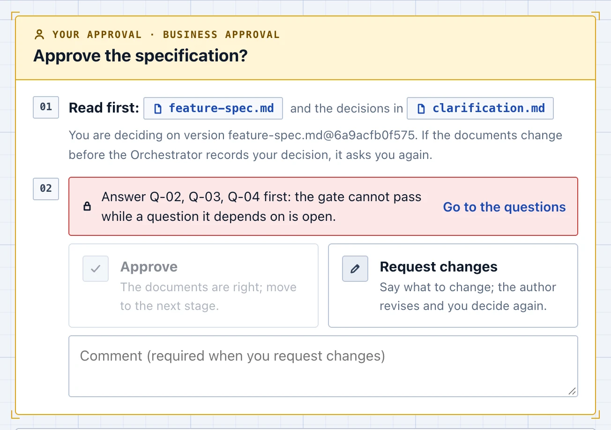

1. **Read first** names the documents and their **version** (a hash of their content). On the board server, each opens as a readable page:

   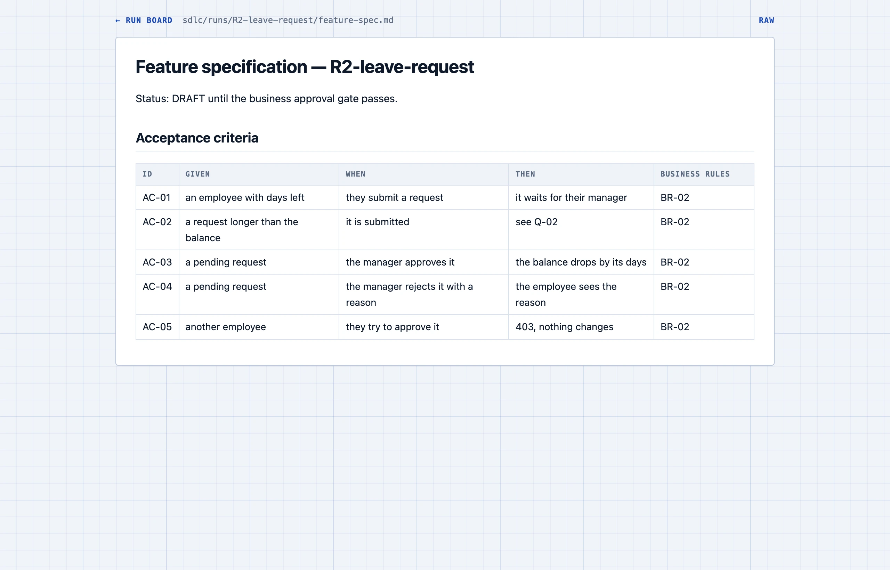
2. The card lists the specification's **assumptions**. Approving the specification approves them; to decide one yourself, request changes and name it, and it comes back as a question.
3. Read **Check before you decide**. It says, for example, when the specification holds more than twelve criteria: values of one rule then usually stand as criteria of their own. Request changes and say so.
4. **Approve** or **Request changes** (a comment is required for changes). Approve stays locked while a question this gate depends on is still open.

What to look at in the specification:

| Part | Ask yourself |
| --- | --- |
| Business rules | Is each rule mine, or marked as an assumption or an approved constraint with its source? |
| Assumptions | Would I have decided each of them this way? |
| Acceptance criteria and their cases | Could I tell, from the outside, whether each one holds? Is anything I expect missing? |
| Out of scope | Is what I do not want built named? |

**What happens.** The reply carries `businessApproval: APPROVE <documents>@<version>`, for example `feature-spec.md@3fa2b1c9d0e4`. The Orchestrator records the approval only if the documents still have that version; if they changed in the meantime, it asks you again. You can also approve in the Orchestrator's session, in your own words: it records them with the version it asked you about.

After that the gate check holds the documents to that version. An approved document that changes needs your approval again, and the board says so on its first line and gives you the approval card for the version it has now.

**You get.** The gate `businessApproval` passed, with a record of who approved, when and which version.

**Next:** the plan.

### 13. Step 4: plan, and approve the plan

**You do.** Start a **new** Orchestrator session and send:

```text
/imperata-plan <runId>
```

A session that Send starts on the board (section 20) goes on to the plan by itself.

**What happens.** The Architect writes `technical-plan.md`: the decisions, and the work cut into tasks. When the feature changes the user interface, the UX Designer first writes a design brief, `design.md`, and the Architect plans from it. Each task has:

| Field | Says |
| --- | --- |
| Acceptance criteria | The criteria the task carries out |
| `Complexity` | `low`, `standard` or `high`, with a one-line reason. It chooses the model: `haiku`, `sonnet` or `opus` |
| `Skills` | The stack skill the task needs, and the product rule it must honor |
| `Owner check` | What you run or open once the task is done, and what to expect |
| Verification command | The command that shows the task works |

**You do, again.** Read the plan and approve it on the board, as you approved the specification. This is your second gate, `planApproval`.

- The approval card names `technical-plan.md`, and `design.md` when the run has one.
- It lists the plan's **decisions**, those in a security-sensitive area first. Approving the plan approves them.
- Look at the ratings: a task rated `high` runs on the strongest model. The ratings are the Architect's judgement, and this is where a person reviews them.

**You get.** The gate `planApproval` passed, and the board at "Ready to build" with the next command.

**Next:** build.

> **Why a new session for each command.** A resumed session reads its whole conversation again at every turn, and it acts on what it knew when it stopped. A step in a long resumed session therefore costs far more than the same step in a new one, and it may act on a state that has changed since. So `/imperata-plan`, `/imperata-implement` and `/imperata-verify` each start a new session, as do `/imperata-merge` and `/imperata-close`.

### 14. Step 5: build, one task at a time

**You do.** Start a new **interactive** Orchestrator session and send:

```text
/imperata-implement <runId>
```

A session that Send starts on the board (auto-run) may not change code, so it stops before implementation: at "Ready to build" the board tells you to start the implementation session yourself, and gives the command with the run's ID.

**What happens, for each task.**

1. The Developer writes the code and runs the targeted tests.
2. The QA Engineer tests the criteria that task names.
3. The Orchestrator records the test lock (section 15) and stops. It tells you what changed, which criteria the tests pass, and how to check the task: the `Owner check` of the plan, such as a command to run or a page to open.

The board then reads "Your move" with that check.

**You do, after each task.** Try it.

- **It works:** tell the Orchestrator to go on, in its session, or send `/imperata-implement <runId>` again in a new one. Between two tasks either way works: the same session when you check soon, a new one when you come back later.
- **Something is wrong:** tell it that instead. It is repaired before the next task.
- You can ask for several tasks before the next stop, in so many words.

Your word after each task is kept in `delivery.md`, under "Checked by the owner". The stop is there so that you check a run in pieces small enough to check. It is not a gate, and your acceptance at the end is still the decision on the whole.

What to look at on the board while it runs:

- **Tasks** tab: tasks in **waves** (tasks in one wave do not depend on each other), each with its `Complexity` and the model it calls for (`low` → `haiku`, `standard` → `sonnet`, `high` → `opus`), the acceptance criteria it serves, and whether development, QA, your check and repairs happened.

  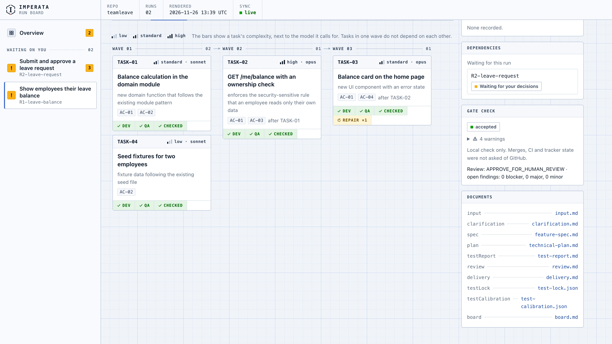
- **Traceability** tab: every acceptance criterion with its tasks, its tests and their result. Select a criterion to read it in full: its Given, When and Then, its business rules, and its cases, each with its tests and its result.

  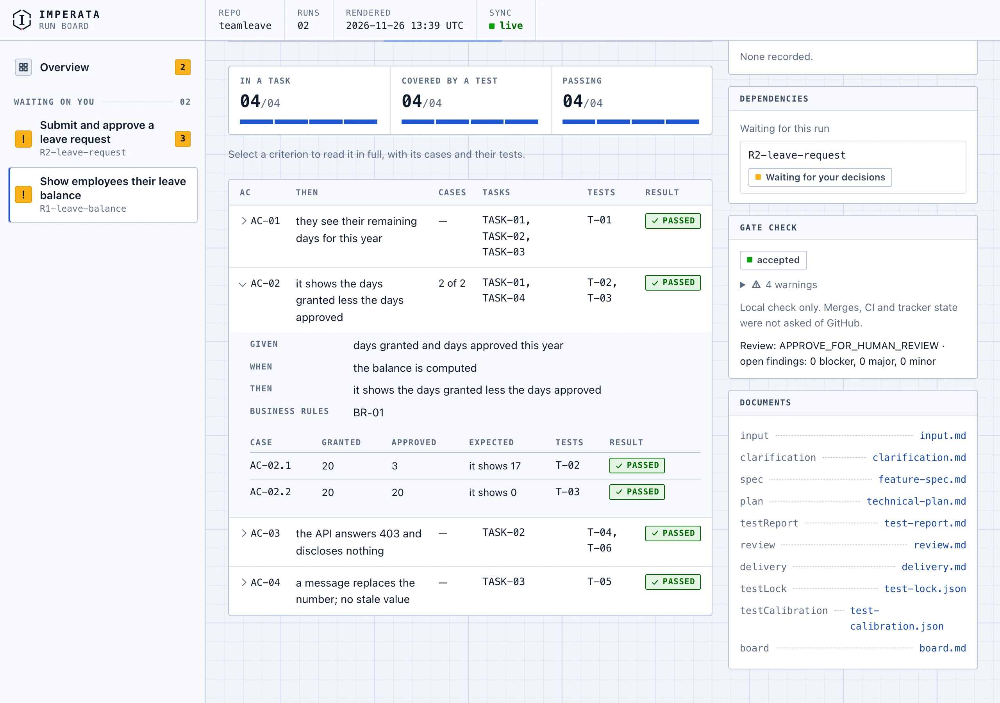
- **Gate check** (right column): the result of `scripts/validate-gates.mjs` for the run, with its warnings.

**You get.** Every task built, tested and checked by you.

**Next:** verify.

### 15. Step 6: verify

**You do.** After the last task, start a new Orchestrator session and send:

```text
/imperata-verify <runId>
```

It is your word for the last task.

**What happens.**

1. The QA Engineer runs the whole test suite and writes the test report, with the commands that really ran and their exit codes.
2. The Orchestrator calibrates the tests (below).
3. The Code Reviewer reviews the diff of the delivery, with the tests and the delivery dossier. Its findings, rated `BLOCKER`, `MAJOR` or `MINOR`, are saved as `review.md`.
4. When no finding stands in the way, the run reaches `READY_FOR_ACCEPTANCE`.

**Repairs.** When QA or the review finds a defect, the Developer gets a scoped fix, then the tests run again: at most two automatic attempts per defect, each one model level higher, then the run is `BLOCKED` and comes back to you. On a light run, a repair that reaches `high` (`opus`) moves the run to the full track, and the plan then needs your approval. A repair after you answered review findings starts with `/imperata-verify <runId>`.

**You get.** `test-report.md`, `review.md` and `delivery.md`, and an approval card for the acceptance.

**Next:** accept.

#### Tests are locked after QA

Once the QA Engineer has tested a task, the Orchestrator records a **test lock**: a list of the run's test files and their fingerprints, in `sdlc/runs/<runId>/evidence/test-lock.json`, recorded again after each task's tests. From then on the Developer may write and fix the application code but not the tests, in a later task as well as in a repair. If a test changes, disappears or the lock is missing, the gate check rejects the run before review, and the board shows it under "Check before you decide". When the Developer believes a test is wrong, the QA Engineer decides, not the Developer.

#### Tests are checked against the code before the run

A test that also passes on the code as it was before the run says nothing about the run. Once the tests pass, the Orchestrator **calibrates** them: `scripts/lock-tests.mjs calibrate` runs each test file of the run on the delivery checkout, where it must pass, and on the commit the run started from, where it must fail. A file that passes on both goes back to the QA Engineer, and the gate check rejects the run before review until the test depends on the change, or the test plan lists the file as one that must pass without it (a regression guard). The board's gate check shows each such guard as a warning, and warns when a run's tests were not calibrated. The result is in `sdlc/runs/<runId>/evidence/test-calibration.json`. Calibration finds the test that cannot fail; it does not tell you that a test checks the right thing.

A test must also give the same verdict every time. Before it calibrates the files, the Orchestrator runs the whole suite five times on the same code (`--suite`). If it fails in any of those runs, even once, the gate check rejects the run before review, and the QA Engineer finds the test that failed. Running the suite again does not clear that failure; only the QA step after a fix does. Five runs that all pass do not prove the tests steady: a test that fails once in twenty runs most often passes five.

### 16. Step 7: accept the delivery and merge

This is your third gate, `humanAcceptance`. At `READY_FOR_ACCEPTANCE` the run page shows every step passed and an approval card:

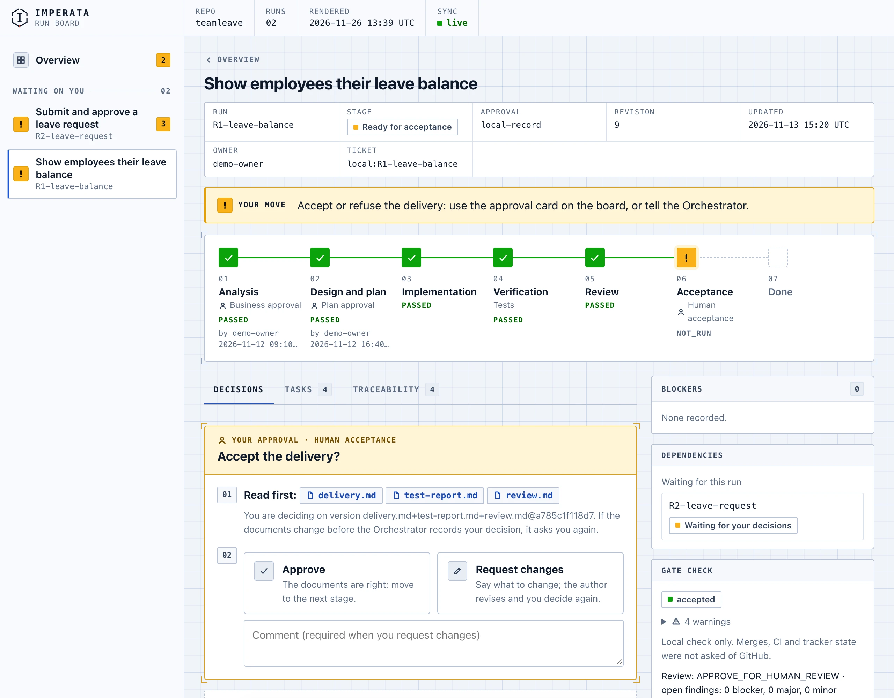

**You do.** Read three documents, then approve or request changes.

| Document | Read it for |
| --- | --- |
| `delivery.md` | The traceability, the model of each task, and what is proven and what is not |
| `test-report.md` | The commands that really ran, with their exit codes |
| `review.md` | The findings, and what was done with each |

Before you approve, check the board's **Check before you decide** list: a criterion with no task or no test, a failing test while the tests gate says `PASSED`, every review finding still open in `review.md` (a `MINOR` one too, by its ID), and a test calibration that ran without a control, which proves nothing about the tests.

**What happens, and what is left.**

- **In `local-record` mode** your Approve is the acceptance. The board then shows the run as **Accepted**, with one step left: merge the delivery into the main branch, yourself or with this command in a new Orchestrator session:

  ```text
  /imperata-merge <runId>
  ```

  The command's words are your instruction to merge, and the Orchestrator quotes them in the manifest. Do not send it to the session that implemented the run: that session knows nothing of your acceptance, and may record it a second time. The Orchestrator then records the merge in `externalEvidence.localMerge` and marks the run `DONE`; the gate check asks git whether that commit is on the main branch and holds the tests you accepted. Runs that wait for this one go on once it is `DONE`.
- **In `pull-request` mode** only merging the delivery pull request accepts the delivery. The Orchestrator never merges. After you merge it, `/imperata-close <runId>` in a new Orchestrator session records `DONE`.

**You get.** A run at `DONE`: the code on your main branch, and in `sdlc/runs/<runId>/` the record of what was asked, decided, built, tested and reviewed.

---

## Part 4: other ways to run

<p align="center">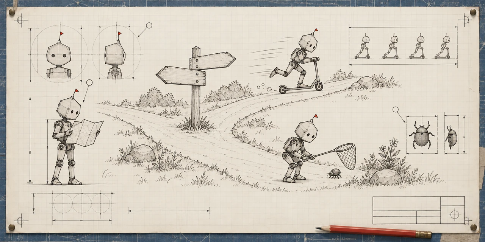</p>

### 17. The light track for small changes

For a small, low-risk change the Orchestrator may propose the **light track** when it starts the run. If you agree, the run has two approvals instead of three: you approve the specification and you accept the delivery. The plan is still written, and independent testing and review still happen, but the plan has no approval of its own; you see it with the delivery.

- The Orchestrator only proposes; you decide. If you say nothing, the run is on the full track.
- A light run shows a **light track** chip on the board, and the approval card for the specification reminds you what approving means.
- The gate check keeps a light run small: a plan with more than three tasks, with a task of `high` complexity (which includes anything touching a security-sensitive area of your project profile), or with a `TASK-00` that writes a stack skill, is rejected, and the Orchestrator moves the run to the full track and asks you to approve the plan.
- To refuse the light track later, choose "Request changes" on the specification card and say so.

### 18. Fixing a bug

A bug fix is a run like any other, with the same gates and checks, recorded as `kind: bug`. Start it with `/imperata-bug` followed by the report (what happens, what should happen, how to reproduce it, where it was seen), in an interactive session: showing the bug runs the project's tests, which a session that Send starts on the board may not do. Three things differ:

- **The bug is shown before you approve anything.** The Business Analyst writes the specification's "Defect" section (what happens, what should happen and the source that says so, how to reproduce it) and the regression criterion, which is the specification's only criterion unless the fix needs another: behaviour the fix must leave as it is, and that a test of the repository already holds, is listed under "Must stay as it is" with that test. The QA Engineer writes a test that fails on the current code, and `scripts/lock-tests.mjs reproduce` records that it fails, with the commit, in `evidence/reproduction.json`. The approval card of the specification shows it, and the gate check rejects an approved bug run without it. If nobody can make the bug show, no fix is planned and the question comes back to you.
- **The plan starts with the root cause.** The Architect names it in the code and plans the smallest change; the parts of the plan the fix does not touch read "N/A".
- **A security bug can stay confidential.** When the defect touches a security-sensitive area, the Orchestrator asks whether it must stay unpublished until it is fixed. If so, the run uses `local-record` mode: nothing is pushed and no pull request is opened before you accept the fix, and publishing it is yours.

After the fix, the test that showed the bug is locked like the others, and calibration shows that it passes with the fix and fails without it. A small, low-risk bug can take the light track: you approve the specification with its reproduction, then accept the fix.

### 19. Approval modes: local-record and pull-request

The Orchestrator asks at the start of each run which approval mode it uses. The agents do the same work in both; what changes is how each of your gates is passed and where the proof of it lives. In `local-record` mode you approve on the board and your decision is saved in the run folder; in `pull-request` mode each gate is a pull request on GitHub, and your merge is the approval.


In `pull-request` mode the three pull requests come from three branches of the run:


| | `local-record` | `pull-request` |
| --- | --- | --- |
| Use it for | the first runs, no GitHub remote, pushes not authorized | once the roles work, with a GitHub remote |
| A human gate passes when | your decision file exists and `approvals.<gate>` points at it | you merge the pull request of that gate |
| The tests gate passes on | the QA test report | the CI run on the delivery pull request |
| Checkable outside the repository | no; the validator warns | yes, with `validate-gates.mjs --verify-remote` |

To set up `pull-request` mode (steps 5–6 of `.orchestra/STARTER_GUIDE.md`):

1. A GitHub remote, `gh auth login`, and your explicit permission for the Orchestrator to push branches and open pull requests.
2. Rename `.github/workflows/pr-checks.yml.example` to `pr-checks.yml`, replace the commands marked `REPLACE` with your real ones, and make both jobs required checks.
3. Protect the main branch so that only a person can merge.

Each run then uses three branches and three pull requests: `sdlc/<runId>/spec`, `sdlc/<runId>/plan` and `sdlc/<runId>/delivery`. In a personal repository the same account opens and merges each pull request; the validator warns about it. Read the pull request before you merge it: that reading is the independent approval.

### 20. Auto-run: the Orchestrator continues after each Send

```bash
node scripts/board-server.mjs --auto-run claude
```

With `--auto-run claude` (or `copilot`), each Send starts a fresh, non-interactive Orchestrator session that may use the tools listed in `.orchestra/auto-run.json`: writing under `sdlc/`, the validator, the renderer, the script that records a change to the manifest (it refuses to commit in such a session), `git status`, `git rev-parse`, `git branch --show-current`, `ls`, `date` and, for Claude Code, `echo`, besides reading files and delegating to the specialists. Allow rules in your own settings of Claude Code or Copilot apply to such a session as well, and nobody is there to approve what they allow, so keep them narrow.

| What such a session does | What it does not do |
| --- | --- |
| Records your decisions | Commit, push or open pull requests |
| Asks read-only specialists to redraft | Write application code or run your tests |
| Goes on to the plan after an approved specification | Implement: that needs a session you are in |
| Stops at the next human gate | Decide anything for you: a gate of yours passes only on the reply you sent |

- **Budget.** With Claude Code each session has a budget cap (`maxBudgetUsd` in that file, or `--budget <usd>`). Claude Code checks it between turns, so a session can end a little above it.
- **One at a time.** One session runs at a time; later Sends queue; its output is in `sdlc/.auto-run/`.
- **The panel** at the top of the board shows the report of the last session, until the run changes after it: then another session has taken the run on, and the panel says so instead of showing an older report above the board.

Do not use `--auto-run` while you also work in an interactive Orchestrator session on the same run: two Orchestrators would write the same files. The Copilot CLI path was written from its documentation and has not been run.

### 21. Claude Code or GitHub Copilot

Drive each run with **one** tool from start to finish. The run protocol (manifest, validator, templates, board, gates) is the same for both; what differs is how firmly the rules are held:

| Rule | Claude Code | Copilot |
| --- | --- | --- |
| The Orchestrator delegates only to the six specialists | `Agent(...)` allowlist in its `tools` | instruction |
| The QA Engineer edits only tests and the run folder | hook blocks other edits with the file tools | instruction; git check afterwards |
| `run.json` is validated after each edit | hook | instruction |
| The board is rendered after each edit in a run folder | hook | the Orchestrator renders it |
| A model for each task, from its `Complexity` | the `model` parameter of the delegation | the implement and the verify command name the models for you, since Copilot sets one only when you name it |
| The Orchestrator's own model | the one its file names | the one selected in the model picker: check it before you send a command (see below) |
| No agent writes `decisions/` | hook | instruction |
| No pull request merged with `gh`, no force-push | `deny` permission rules | instruction |
| Push, pull request, issue writes | you are asked each time | instruction: only after you authorize |

**The Orchestrator's model under Copilot.** By the VS Code reference, selecting the agent sets the picker to the model its file names, and a model you select yourself stays for the conversation. The file names `claude-sonnet-5.5`; replace it with an identifier your plan offers. The model of the Orchestrator's session is most of what a run costs, so check the picker before you send a command.

The hooks and rules match the usual way of calling a command, not every possible way. Branch protection, required CI and a person reading the pull request remain the real barrier. Building a foundation with Claude Code and a later feature with Copilot is possible run by run; see "Handing a repository from one tool to the other" in [`CLAUDE_CODE_GUIDE.md`](starter-claude-code/CLAUDE_CODE_GUIDE.md#handing-a-repository-from-one-tool-to-the-other).

---

## Part 5: reference

<p align="center">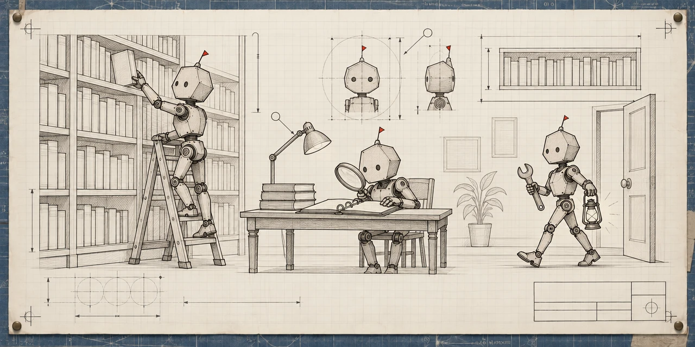</p>

### 22. Stages of a run, and whose move it is

`currentStage` in `run.json` says where a run stands. The board reads it and tells you whose move it is.

| Stage | What it means | Whose move, and what to do |
| --- | --- | --- |
| `NEW`, `ANALYSIS` | The Business Analyst is drafting the specification | The agents'. Wait for the session to report |
| `AWAITING_BUSINESS_DECISION` | Questions wait for you, or the specification waits for your approval | **Yours.** Answer the questions, then approve the specification (sections 11 and 12) |
| `READY_FOR_DESIGN_PLAN` | The specification is approved | **Yours.** With no plan yet: send `/imperata-plan <runId>` in a new session. With a plan: read it and approve it (section 13). On the light track the plan has no approval, and the Orchestrator goes on |
| `READY_FOR_IMPLEMENTATION` | The plan is approved and no task has started | **Yours.** Send `/imperata-implement <runId>` in a new interactive session |
| `IMPLEMENTING` | Tasks are being built and tested, one at a time | The agents', until a task waits for your check. Then **yours**: try it and say go on. After the last task: send `/imperata-verify <runId>` (sections 14 and 15) |
| `VERIFYING` | The QA Engineer is testing independently | The agents' |
| `REVIEWING` | The Code Reviewer is reviewing the diff of the delivery | The agents' |
| `FIX_REQUIRED` | A scoped repair is under way: at most two per defect | The agents'. After two failed attempts the run is `BLOCKED` |
| `READY_FOR_ACCEPTANCE` | Tests and review have passed | **Yours.** Accept or refuse the delivery. Once accepted in `local-record` mode: merge, or send `/imperata-merge <runId>` (section 16) |
| `DONE` | Accepted and merged | Nobody's |
| `BLOCKED` | The run cannot go on. The board gives the reason | **Yours.** Read the reason and decide |
| `CANCELLED` | The run was called off | Nobody's |

The gate check keeps a run out of a stage whose gates have not passed, so a run cannot reach implementation on an unapproved specification by a change of `currentStage` alone. The full table of what each stage needs is in [`docs/04_WORKFLOW_AND_GATES.md`](docs/04_WORKFLOW_AND_GATES.md).

### 23. Inside a run folder


Every artifact follows a template in `.orchestra/templates/`. Commit the run folder with the run, including `board.md` (the board as Mermaid diagrams, which GitHub shows in each gate's pull request). `sdlc/board.html` is generated and ignored by git.

Where to look for what:

| You want to know | Open |
| --- | --- |
| What was asked | `input.md` |
| What I decided, and when | `clarification.md`, and my replies as I sent them in `decisions/` |
| What will be built | `feature-spec.md` |
| How it will be built, and in which tasks | `technical-plan.md` |
| What was tested, with which commands and results | `test-plan.md` and `test-report.md` |
| What the review found | `review.md` |
| What is proven and what is not | `delivery.md` |
| Where the run stands and which gates passed | `run.json`, or the board |

### 24. What the gate check holds a run to

What a run is held to before review and before acceptance. `scripts/validate-gates.mjs` reads the run's files for it; the first point is for the Code Reviewer, and the second is a warning on the board.

- **The rules for tests.** `.orchestra/test-rules.md` holds twelve rules every test of a run is held to: a test must be able to fail, must check the criterion and not the code, and must give the same verdict every time. The Code Reviewer reviews the tests against them.
- **Few criteria, each with its cases.** A criterion is one behaviour: one thing a person does, and what can be observed of its result. The values it holds for (the forms a rule accepts, the ones it refuses, the boundaries) are its cases, in a table of their own in the specification, not criteria of their own. Before you approve a specification, the board says so under "Check before you decide" when it holds more than twelve criteria: values of one rule then usually stand as criteria, and the plan, the test plan, the test report and the dossier each repeat them. Request changes and say so.
- **A test for every acceptance criterion.** From review on, the gate check rejects a run in which a criterion of the specification has no test that passed in the test report; where a criterion has cases, every case needs its test. The only other way is a row under "Not covered" in the test plan that names you as having accepted the gap: the Orchestrator asks you, and the board shows every accepted gap as a warning.
- **A test for every decision in a security-sensitive area.** The Decisions table of the plan says which decisions settle authentication, authorization, permissions, audit, secrets, git writes, a service that answers without authentication where a browser or the network can reach it, or an area of your project profile; you approve them with the plan. From review on, each of those decisions needs a test that passed, with its ID in the test report, or a gap you accepted, as a criterion does. A code review reads such a decision once; a test keeps it true in later runs.
- **Skills applied.** The delivery dossier lists, for each task, the rule of the stack skill that shaped the code, quoted from the skill file. The gate check looks every quote up in that file, so a rule nobody read cannot be claimed.
- **The test lock and the calibration** (section 15).

What it cannot tell: whether a test checks the right thing, whether the code follows a quoted rule, and, in `local-record` mode, whether the person named in an approval is the one who gave it. Those are for the Code Reviewer and for you.

### 25. Update the kit

```bash
git -C ~/tools/imperata fetch --tags
git -C ~/tools/imperata checkout v1.0.0
node ~/tools/imperata/imperata-kit.mjs status .
node ~/tools/imperata/imperata-kit.mjs update .
```

`fetch --tags` brings the releases published since you cloned, and `checkout` takes the one you name: `git -C ~/tools/imperata tag --list 'v*'` lists them, and `CHANGELOG.md` says what each one changes. `status` writes nothing and exits 1 when something would change. `update` replaces a kit file only if you have not changed it (it compares with the hashes in `.orchestra/installed.json`); a changed file is reported as a conflict and kept, unless you pass `--force`. `.orchestra/project.md` is never touched. Commit the result in the project.

- **A run in progress** is not affected by an update, except that a Claude Code session resumed later keeps the agent instructions it started with. Start a new session after an update.
- **Your own files are not brought up to a newer kit.** After an update, compare `.orchestra/project.md` and `.orchestra/auto-run.json` with the copies in `starter/.orchestra/` of the kit for a section or a line that the newer kit adds (`KIT_GUIDE.md`, "What the script does not do").

### 26. Troubleshooting

**Setting up**

| Symptom | Likely cause and fix |
| --- | --- |
| `/agents` does not list the seven agents | The kit was installed with `--tools copilot` only, or Claude Code was started outside the project root. Run `imperata-kit.mjs status .` |
| The hook tests of section 8 do not refuse anything | The folder is not trusted, or hooks are disabled by a managed setting. Check `/hooks`. Until fixed, treat the rules as instructions only and say so in every report |
| A command does nothing but say how to start the Orchestrator | It was sent in a plain session. Start `claude --agent sdlc-orchestrator`, or select the SDLC Orchestrator agent, and send it there |
| `imperata-kit.mjs update` reports a conflict | You changed a kit file in the project. Merge the kit version by hand, or rerun with `--force` to take it |

**The board**

| Symptom | Likely cause and fix |
| --- | --- |
| The board page is empty | No run exists yet, or the server runs in another folder. Start it from the project root |
| No Send button, or "Refused: the token does not match" | The page was opened as a file, or the server was restarted since the page loaded (each start writes a new token into the page). Reload it from `http://127.0.0.1:4319/sdlc/board.html` |
| Port 4319 is in use | `node scripts/board-server.mjs --port 4320`. While it runs the server writes its address to `sdlc/.board-server.json`, and the Orchestrator gives you that address |
| The board reads "In progress" and no session is running | The session ended without moving the run to the stage that waits for you, which the Orchestrator is told to set before it reports. If questions are listed below that line, they are yours: answer them and tell the Orchestrator "decisions sent" |

**During a run**

| Symptom | Likely cause and fix |
| --- | --- |
| The Orchestrator does not see your decisions | Tell it "decisions sent". A sent but unrecorded file shows on the board as sent and waiting |
| "Gate validator rejected" | The run tried to enter a stage whose gates or artifacts are missing. Read the listed problems; do not edit `currentStage` by hand |
| Approve is locked | A question needed before this gate is still open. Answer it first |
| The Orchestrator asks you to approve again | The documents changed after you read them, so their version changed. Read them again |
| The specification asks about something your coding convention already decides | The convention is in no stack skill. See section 7 |
| The write of a stack skill under `.claude/skills/` is denied | The session had nobody in it. `TASK-00` runs in a session you are in, and Claude Code asks you to approve the write |
| The gate check rejects a row of "Skills applied" | The quote is not word for word in the file the row names. The Developer returns the list again; nobody mends a quote by hand |
| A test fails only sometimes, and the run is kept out of review | The whole suite failed in one of its five runs. The QA Engineer finds the test; running the suite again does not clear it |

### 27. How far this has been tried

This is a blueprint and a starter kit, not a proven autonomous delivery system. What it has been tried on, and what it has not, is in "Status and boundaries" of [`README.md`](README.md#status-and-boundaries). What never to assume about a run is in [`starter/STARTER_GUIDE.md`](starter/STARTER_GUIDE.md#never-assume).

### 28. Questions people ask

**Can an agent approve a gate or merge for me?** No. The three human gates pass only on your decision, recorded with your words or your merge. No agent can run a command such as `/imperata-merge` by itself, and in Claude Code permission rules deny merging a pull request with `gh` and a force-push. Those rules match the usual forms of these commands, not every way to write them.

**What if I disagree with an assumption of the specification, or a decision of the plan?** Choose **Request changes** on the approval card and name it. An assumption you name comes back as a question for you to decide.

**Can a specification change after I approved it?** Not without you. The gate check holds an approved document to the version you approved. If it changes, the board says so on its first line and gives you the approval card for the new version.

**Where is what I decided?** In `clarification.md`, one row for each question with your decision, your name, the time and the evidence. Your replies from the board are kept as you sent them in `decisions/`, and each approval is in `approvals` of `run.json`.

**How long does a run take, and what does it cost?** It depends on the feature, the models and your plan with the tool. For Claude Code, the board server caps each session it starts (`maxBudgetUsd` in `.orchestra/auto-run.json`).

**My team has its own coding convention. How do the agents follow it?** Through a stack skill: section 7, "Bringing in your team's coding convention".

**Do I have to use the board?** No. Everything the board shows is in the run folder, and you can answer and approve in the Orchestrator's session in your own words. The board makes it harder to miss a question or to approve a version you did not read.

### 29. Command reference

| Command (from the project root unless noted) | What it does |
| --- | --- |
| `node <imperata>/imperata-kit.mjs install <repo> [--tools claude,copilot] [--profile <file>] [--dry-run]` | Installs the kit (`<imperata>` is where you cloned this repository) |
| `node <imperata>/imperata-kit.mjs status <repo>` | Shows what an update would change |
| `node <imperata>/imperata-kit.mjs update <repo> [--force]` | Updates kit files you have not changed |
| `node scripts/validate-gates.mjs sdlc/runs/<runId>/run.json [--verify-remote]` | Checks a run's gates and artifacts; with `--verify-remote`, merges and CI through `gh` |
| `node scripts/render-run-board.mjs [--run <runId>] [--check]` | Renders `board.md` of each run and `sdlc/board.html`; `--check` fails when a committed `board.md` is stale |
| `node scripts/render-run-board.mjs --gate-version <runId> <gate>` | Prints the version of the documents behind a human gate |
| `node scripts/record-run.mjs <runId> --set <field>=<value> … [--commit "<subject>"]` | Records one change to a run's manifest in one call: writes the fields, raises `revision`, takes `updatedAt` from the clock, runs the validator and puts the manifest back when it rejects the change, renders and checks the boards, and with `--commit` commits what is under `sdlc/`. It is how the Orchestrator changes `run.json`; it writes what it is told and passes no gate |
| `node scripts/lock-tests.mjs record\|check <runId>` | Records the test lock after a QA step, or checks that no test changed since |
| `node scripts/lock-tests.mjs calibrate <runId> --cmd "<command with {file}>" --suite "<command>"` | Runs the whole suite several times, then checks that each test file of the run passes with the run's change and fails on the commit the run started from |
| `node scripts/board-server.mjs [--port 4319] [--auto-run claude\|copilot [--budget <usd>]]` | Serves the live board and saves your replies |
| `claude --agent sdlc-orchestrator` | Starts a Claude Code session as the Orchestrator |

The commands you send in a session (`/imperata-start` and the others) are in [section 3](#the-commands).

### 30. Where to read more

| Question | Read |
| --- | --- |
| How the kit is installed, updated and owned | [`KIT_GUIDE.md`](KIT_GUIDE.md) |
| How far the kit has been tried | [`README.md`](README.md#status-and-boundaries) |
| Claude Code specifics, hooks, models, handover between tools | [`starter-claude-code/CLAUDE_CODE_GUIDE.md`](starter-claude-code/CLAUDE_CODE_GUIDE.md) |
| Copilot specifics and what never to assume | [`starter/STARTER_GUIDE.md`](starter/STARTER_GUIDE.md) |
| Purpose, boundaries and how to choose a pilot feature | [`docs/01_EXECUTIVE_BLUEPRINT.md`](docs/01_EXECUTIVE_BLUEPRINT.md) |
| Stages, gates, Definition of Done | [`docs/04_WORKFLOW_AND_GATES.md`](docs/04_WORKFLOW_AND_GATES.md) |
| Roles and delegation contract | [`docs/03_AGENT_ROLES_AND_CONTRACTS.md`](docs/03_AGENT_ROLES_AND_CONTRACTS.md) |
| Moving from a personal pilot to an organization's account | [`docs/07_PERSONAL_TO_ENTERPRISE_MIGRATION.md`](docs/07_PERSONAL_TO_ENTERPRISE_MIGRATION.md) |
| How to evaluate the results honestly | [`docs/08_EVALUATION_AND_TEST_PLAN.md`](docs/08_EVALUATION_AND_TEST_PLAN.md) |
| The images in these guides, how to regenerate the diagrams and screenshots, and how the illustrations were made | [`docs/images/README.md`](docs/images/README.md) |
