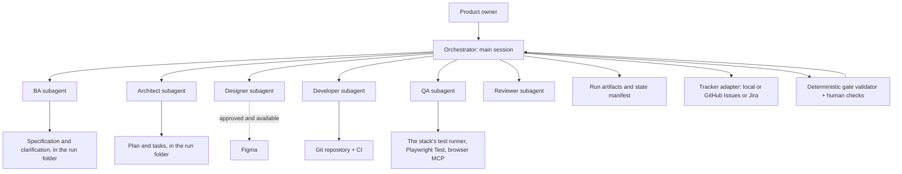

# 02 — Runtime, orchestration model and repository boundaries

**Doc ID:** ORCH-002 | **Status:** Proposed

## Runtime selection

Imperata supports two agent tools. The run protocol, the manifest, the templates and the scripts are the same for both; the agent files differ.

- **GitHub Copilot in VS Code, Copilot harness.** Custom agents live in `.github/agents/*.agent.md`. The Orchestrator is a custom agent selected in the harness and calls specialist agents through Copilot's native delegation (`task` tool under the `agent` alias). The **Local harness** has different `runSubagent`, handoff and MCP semantics. Do not mix settings without testing in the selected harness.
- **Claude Code.** Agents live in `.claude/agents/*.md`. The Orchestrator is the main session, started with `claude --agent sdlc-orchestrator`, and delegates to the specialists named in its `tools` field. Permission rules and hooks in `.claude/` back some of the rules (`starter-claude-code/CLAUDE_CODE_GUIDE.md`).

Both tools change their capabilities over time; agent files loading and displaying does not prove every requested tool is callable. Re-test after upgrading VS Code, Copilot CLI or Claude Code, or after the organization changes its policies.

## Conceptual topology


The same topology with the integrations it may reach:



**Important:** This diagram is the intended sequence, **not** proof that the agent tool automatically schedules these nodes or can launch background jobs. Each delegation call is a bounded task; the coordinator must read returned results and decide what to do next.

## Two orchestration layers

- **LLM coordination layer:** chooses who to ask and synthesizes phase outputs; can propose a retry/repair.
- **Process layer:** persisted run manifest, required artifacts, shell/CI/test exit codes, reviewer sign-off, manual approvals. Prevents optimistic “done” claims.

A full durable, crash-recovering orchestration *engine* is out of scope. The kit offers a reproducible run protocol and a gate validator. True resume needs additional implementation and verification.

## Authoritative run state

Store `sdlc/runs/<run-id>/` in the working repository (or separate restricted evidence storage):


```text
sdlc/runs/R001-example/
  run.json                  # machine-readable state
  input.md                  # original requirement & source refs
  clarification.md          # questions, decisions, owner, approvals
  feature-spec.md           # approved AC
  design.md                 # Figma link / design decision / N/A
  technical-plan.md         # ADR links + tasks
  test-plan.md              # independent QA matrix
  test-report.md            # commands that really ran, with exit codes
  evidence/                 # command logs, JUnit, traces, screenshots, test lock
  review.md                 # findings + dispositions
  delivery.md               # acceptance and links
  decisions/                # the owner's replies, saved by the board server
  board.md                  # the run board, rendered for pull requests
```

Synthetic data may be committed. Real log output may hold sensitive content and belongs in approved restricted storage. Redact tokens, personal data and repository secrets.

## State contract

`NEW → ANALYSIS → AWAITING_BUSINESS_DECISION → READY_FOR_DESIGN_PLAN → READY_FOR_IMPLEMENTATION → IMPLEMENTING → VERIFYING → REVIEWING → READY_FOR_ACCEPTANCE → DONE`.

Alternate states: `FIX_REQUIRED`, `BLOCKED`, `CANCELLED`. `DONE` requires the owner's acceptance and the merge of the delivery: in `pull-request` mode the delivery pull request, in `local-record` mode a merge into the main branch that git confirms (`externalEvidence.localMerge`); and the tracker's status where the run has a real tracker. Until then the run reports `READY_FOR_ACCEPTANCE`.

The state JSON must include `runId`, `productDocVersion`, `ticketRef`, `currentStage`, `revision`, `approvalMode`, `approvals`, `artifactPaths`, `gateResults`, `owner`, `updatedAt`, `openBlockers` and `externalEvidence`. `approvalMode` and `approvals` are described in `04_WORKFLOW_AND_GATES.md`. The kit keeps no log of transitions and compares no expected `revision` before a write; the history of `run.json` in git is the record ("What the manifest keeps of a transition" in `04`). Only the Orchestrator writes the manifest, so two agents never edit it at once.

## Branches and pull requests (pull-request mode)

A run uses three branches in turn, each ending in a pull request that a person merges: `sdlc/<runId>/spec`, `sdlc/<runId>/plan` and `sdlc/<runId>/delivery`. The run folder travels with them, so the manifest on the main branch always shows the last stage a person approved. Implementation, QA and review all happen on the delivery branch; nothing reaches the main branch before independent testing and review. In `local-record` mode the run stays on one working branch and no pull request is required.

## Worktrees and parallelism

Modifications are sequential, one writer at a time, to avoid conflicted files; independent read-only reviews may run after contracts are approved. Never run several writers against the same checkout/state JSON. Require branch ownership and rebase/merge review.

## Role independence

QA should derive a test plan from approved requirements, not just developer-provided test descriptions. Reviewers inspect diffs with read-only tools and call out testability, security and contract issues. The Orchestrator must never manufacture PASS from their prose.
