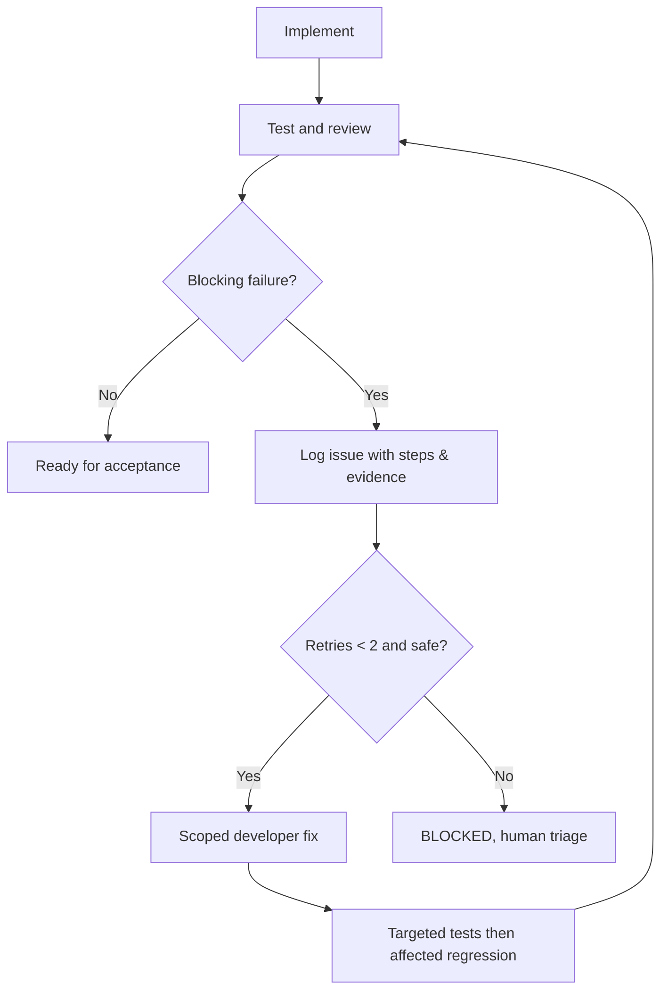

# 04 — SDLC workflow, states, quality gates and repair policy

**Doc ID:** ORCH-004 | **Status:** Proposed

## Stage protocol

| Stage | Primary actor | Evidence required | Gate / outcome |
| --- | --- | --- | --- |
| 0 Intake | Orchestrator | Original text, source version, tracker ID or local ID | Scope + source identified |
| 1 Discovery | BA | Assumptions, user stories, AC, open questions | Business approval or BLOCKED |
| 2 Design (conditional) | UX Designer | Flows, states, accessibility, Figma references or explicit N/A | No gate of its own: the design brief is approved with the plan |
| 3 Technical planning | Architect | ADR, data contracts, threat notes, tasks/dependencies | Plan review |
| 4 Implementation, one task at a time | Developer, then QA for the task's criteria | Code diff, the task's tests, commit/PR link | The owner's check after each task, which is not a gate; build/typecheck/unit tests passing |
| 5 Verification | QA | Independent test matrix, the whole suite, real command exit codes, logs/traces | QA gate PASS/FAIL |
| 6 Code review | Reviewer | Review findings and actions | Zero unresolved blockers |
| 7 Delivery | Orchestrator + PO | Traceability, evidence, CI status, merge approval | READY_FOR_ACCEPTANCE → DONE |

In `pull-request` mode the approvals in stages 1, 3 and 7 are pull request merges, and the stage 5 gate is the CI run on the delivery pull request; see "Human gates as pull request merges" below.

No stage uses Spec Kit, also where it is installed: the specification and the plan are files of the run folder, written from `.orchestra/templates/` (`05_SPEC_KIT_AND_TRACEABILITY.md`).

## Source-to-evidence chain

`BR ID → FR/AC ID → Jira/GitHub Issue → Task ID → PR/Commit → Unit/API/E2E Test ID → Test result → Review → PO acceptance`.

Example: `FR-012 → AC-02-03 → ABC-42 → TASK-07 → PR#14 → test:rejected-without-permission → PASS → accepted`.
All IDs in examples are illustrative.

## No-silent-pass rules

- Check results from actual processes: exit code, test report counts, command, branch/commit, date/time and environment.
- A screenshot with a green UI label is insufficient to prove an invariant.
- `SKIPPED`, `NOT_RUN`, `UNAVAILABLE`, `UNKNOWN` are not `PASSED`.
- If Jira/Figma access is unavailable, create a **draft/local artifact** and mark external sync as `NOT_RUN` rather than claim it happened.
- If tests fail, record failures and route fix; do not change AC to fit code.
- If test environment cannot reproduce concurrency, supplement with backend transactional tests.

## Repair loop

Maximum **two automatic repair attempts per defect**, set in the Orchestrator's instructions; no automatic speculative “fix” of an ambiguous business rule. Stop for data loss risk, policy violation, missing auth, uncontrollable cost, or any deployment beyond a disposable test environment.

## Definition of Ready (DoR)

- Approved AC are testable, bounded and linked to baseline product docs.
- Owner, priority, dependencies, out-of-scope and data fixtures identified.
- Security/access questions resolved for tasks that write to external systems.
- Architecture/design prepared where needed.

## Definition of Done (DoD)

- Required AC acceptance evidence exists.
- Relevant build/typecheck/lint/unit/integration/contract/e2e checks run and pass, with justified omissions.
- Reviewer blockers resolved; security cases covered.
- CI required checks pass for the exact reviewed commit; any later commit on the delivery pull request changes only the run folder.
- The delivery is merged by an authorized person, or at that person's word: the delivery pull request in `pull-request` mode, the main branch in `local-record` mode; the tracker status is genuinely updated where the run has a tracker. Otherwise the result is stated as `READY_FOR_ACCEPTANCE`, not Done.
- All external IDs/URLs and evidence paths are real and verified.

## Gate prerequisites per stage

A run may be in a stage only when the gates and artifacts below are already in place. The starter validator (`scripts/validate-gates.mjs`) rejects a manifest that breaks this table, so a run cannot move to implementation on an unapproved specification by editing `currentStage` alone. Only `PASSED` satisfies a prerequisite; `WAIVED` does not.

| Stage | Gates that must be `PASSED` | Artifacts that must exist |
| --- | --- | --- |
| `NEW`, `ANALYSIS`, `AWAITING_BUSINESS_DECISION`, `BLOCKED`, `CANCELLED` | none | none |
| `READY_FOR_DESIGN_PLAN` | `businessApproval` | input, spec |
| `READY_FOR_IMPLEMENTATION`, `IMPLEMENTING`, `FIX_REQUIRED` | `businessApproval`, `planApproval` (on the light track: `businessApproval` only, see "Tracks") | input, spec, plan |
| `VERIFYING` | the above and `implementation` | input, spec, plan |
| `REVIEWING` | the above and `tests` | input, spec, plan, test report, and the test lock, unbroken (see "Test lock"); no calibrated test file that passes without the run's change, and no run of the whole suite that failed on the lock as it is now (see "Test calibration"); every acceptance criterion, and every decision of the plan in a security-sensitive area, with a passed test or an accepted gap |
| `READY_FOR_ACCEPTANCE` | the above and `review`; no open blockers, and a review that says `APPROVE_FOR_HUMAN_REVIEW` and leaves no BLOCKER open (see below) | all six, including review and delivery |
| `DONE` | as `READY_FOR_ACCEPTANCE`, plus `humanAcceptance`; in `pull-request` mode a real PR URL, verified merge and verified tracker status; in `local-record` mode a merge into the main branch that git confirms (see "Done in local-record mode"), and the tracker status where the ticket names a real tracker | all six |

A human gate that is `PASSED` must also have a record in `approvals` saying who approved, when, and where that can be checked. Without `--verify-remote` the validator reads the manifest only and cannot tell whether the record is true. In `local-record` mode it reads the record itself: the file must hold the line the board sends, `<gate>: APPROVE <documents>@<version>`, and the version must be that of the gate's documents now, computed as `render-run-board.mjs --gate-version` computes it. A record that only asks for changes, one that names no version, and documents changed after their approval fail the manifest until the owner approves the current version. The owner's last decision on a gate stands: a record whose last line on the gate is `REQUEST CHANGES`, or a reply in `decisions/` saved after the recorded approval that asks for changes, fails the manifest as well. In a reply the board saved, a decision is read only at the start of a line, where the board writes it; the owner's name and the ids of questions, which agents write, go into the reply on one line. An approval of kind `pull-request` in `local-record` mode, or of kind `local-record` in `pull-request` mode, fails the manifest. So does a passed gate while a question of `clarification.md` that must be decided before it is still `OPEN`, which the run board flags as well. A record under the run's `decisions/` is meant to be the owner's reply as the board server saved it; any other was written by the Orchestrator from the owner's words, and the validator's warning says which. No agent may write under `decisions/`: in Claude Code a hook refuses an edit there made with the file tools, though not a shell command; under Copilot it is an instruction only.

Once the manifest names a plan, the validator also reads the plan's `### TASK-NN` sections (and those of the file in `artifactPaths.tasks`, when the task breakdown has its own file). Every task must carry a `Complexity` of `low`, `standard` or `high` with a one-line reason, because the Orchestrator chooses the model for a task from it. A task without one fails in any stage; a plan with no task section at all fails from `READY_FOR_IMPLEMENTATION` on and is a warning before that. The validator checks that the field is there and well formed, not that the level is right.

Once the manifest names the delivery dossier, the validator reads its "Model per task" table. Each row is one delegation of a task: the task, the step (`developer`, `qa` or `repair`, or `verification` for the whole suite after the last task, a row that names no task and is held to no task's level), the level it ran at, the model requested (or `NOT_SELECTED`) and `CONFIRMED` or `NOT_CONFIRMED`. A row with an empty or invalid cell, a task that is not in the plan, or a level below the plan's fails in any stage. A missing table, an empty table or a task without a `developer` row fails from `READY_FOR_ACCEPTANCE` on and is a warning before that. The table is written by the Orchestrator, so the validator cannot tell which model really ran or whether a delegation is missing from it.

From `REVIEWING` on, the validator reads the acceptance criteria of the specification (the `AC` ids in the `ID` column of its tables; where it has no such table, every `AC` id its text names) and the Results table of the test report. Every criterion needs a test that passed. Where a criterion has cases (the rows `AC-NN.M` of a table whose first column is `Case`), every case needs one: a test names a case by its id or in a range of cases (`AC-03.1..AC-03.4`), and a test that names the criterion alone covers none of them. A criterion without a test must be listed under "Not covered" in the test plan (`artifactPaths.testPlan`, or `test-plan.md` in the run folder) with who accepted the gap; an accepted gap is a warning the owner sees. A criterion with a `FAILED` test, or with tests none of which passed, fails the manifest, and so does a test report without a Results table. A criterion that the report names and the specification does not have is a warning. A specification with no `AC` id at all fails the manifest: a specification written from Spec Kit's template numbers its requirements `FR-` and `SC-`, and the check would otherwise pass it without checking anything. The validator reads what the QA Engineer and the Orchestrator wrote: it cannot tell whether a test checks its criterion, or whether the owner really accepted a gap.

Three warnings read the run's documents and its manifest. Before the business approval, a specification with more than twelve criteria is named: a criterion is one behaviour, and the values it holds for are its cases. In every stage, a table row with more or fewer cells than its table has columns is named with its document: every script ends a cell at a `|` that has no backslash before it, also inside a code span, so what is read from such a row comes from the wrong column; the board lists the same rows under "Check before you decide". And a time in the manifest that is more than a minute ahead of the machine's clock is named: it was not read from the clock.

In the same stages, every test the matrix of the test plan marks `Mandatory` must have `PASSED` in the Results table of the test report. A passed test of the same criterion does not stand in for it: T-01 `PASSED` does not cover a mandatory T-04 `NOT_RUN`. A mandatory test that is `NOT_RUN`, `BLOCKED`, `FAILED` or missing from the report fails the manifest, unless "Not covered" lists its Test ID with who accepted the gap, which is a warning. In a bug run, a matrix row whose test file showed the bug is mandatory whatever its column says, and each such file needs a row. A matrix without a `Mandatory` column is a warning. The QA Engineer fills the column; whether a test should have been marked is not checked.

In the same stages, every decision of the technical plan whose `Security-sensitive area` is not `no` is held as a criterion is: it needs a test that passed in the Results table of the test report, with the decision's ID in the AC column, or a row under "Not covered" in the test plan with who accepted the gap. The Architect names the area a decision settles (authentication, authorization, permissions, audit, secrets, git writes, a service that answers without authentication where a browser or the network can reach it, or an area of the project profile) and the owner approves it with the plan. A review reads such a decision once; a test holds it in every later run. A decision with no test, with a `FAILED` test or with no test that passed fails the manifest; an accepted gap is a warning. A Decisions table without the column, and a decision whose cell is empty, are warnings. The validator cannot tell whether a test checks its decision, or whether a decision marked `no` settles such an area after all.

Once the dossier has a "Skills applied" table, the validator reads it in every stage but `DONE` and `CANCELLED`. Each row names a task of the plan, a skill file in the repository that the task's `Skills` field names (by its path, by the name of a stack skill, or by a path inside a skill folder), the rule applied, quoted from that file, and where it was applied. A quote that is not in the file word for word (Markdown marks and line breaks aside) fails the manifest, as does a file that does not exist, a file the task's `Skills` field does not name, a task the plan does not have, a quote under twelve characters or an empty "Where". `none` in place of a quote says that nothing in the file bore on the task. A missing table, an empty one and a task without a row are warnings from `READY_FOR_ACCEPTANCE` on. The check shows that the quote was copied from the file; whether the code follows the rule is for the Code Reviewer.

Once the `review` gate is `PASSED`, the validator reads the review the manifest names, as the run board reads it: its "Verdict:" line must say `APPROVE_FOR_HUMAN_REVIEW` (the last such line, where a review read again adds a round below the first), and no finding of severity BLOCKER may be left open (a Disposition that is empty or `OPEN`). `CHANGES_REQUIRED`, no verdict, or an open BLOCKER fails the manifest; an open MAJOR is a warning. The Code Reviewer is read-only, so the Orchestrator writes `review.md` from its findings: the validator catches a manifest that disagrees with the review, not a review that leaves out a finding or marks one dealt with when it was not.

In every stage the validator also reads the documents the owner approves (specification, plan, test report, review, delivery dossier) for characters that cannot be seen: a letter in decomposed form, whose combining marks look like the composed letter, and zero-width, joiner and direction marks. Each line that holds one is a warning that names the file, the line and the code points; at most three lines per file. The analyst writes such a character as an escape (`\u0302`) and says in words what it is, and the Orchestrator saves the escape as written. It is a warning and not a problem because sources typed in decomposed form are real; the validator cannot tell a mark that was meant from one that was not.

## Tracks: full and light

Every run is on the `full` track, the protocol above, unless its owner agrees to the `light` track. The light track is for a small, low-risk change, where three approvals cost more than they protect.

| | `full` | `light` |
| --- | --- | --- |
| Human gates | `businessApproval`, `planApproval`, `humanAcceptance` | `businessApproval`, `humanAcceptance` |
| `planApproval` in the manifest | `PASSED` before implementation | `WAIVED`, with no record in `approvals` |
| Plan | Approved on its own | Written by the Architect, checked by the validator, shown to the owner with the delivery |
| Pull requests in `pull-request` mode | specification, plan, delivery | specification, delivery (the plan is committed on the delivery branch) |
| Independent testing and review | Yes | Yes, unchanged |

A light run records `track: light` and `trackDecision` (`by`, `at`, a one-line `reason`, optionally `recordPath`). The validator rejects a light run:

- without a complete `trackDecision`;
- whose `trackDecision.at` is after the business approval: the specification was approved on the full track, and its card did not name the light one;
- whose `planApproval` is not `WAIVED`, or whose `approvals.planApproval` holds a record;
- whose plan has more than three tasks, a task of `high` complexity, or a `TASK-00`: a stack skill sets conventions every later run follows, and the owner approves them with the plan;
- with a "Model per task" row that ran at `high`.

Because `.orchestra/project.md` makes every task that touches a security-sensitive area `high`, such a change cannot stay on the light track. A run that fails one of these checks moves to the full track: `track: full`, `trackDecision: null`, `planApproval: NOT_RUN`, and the plan is approved before any further implementation.

The Orchestrator proposes the light track and the owner decides; no agent chooses it. On the board a light run carries a "light track" chip, and the approval card for the specification says that approving it also lets implementation start once the plan is written.

Limits:

- The validator sees the number of tasks and their levels, not the size of the change. A plan of three large tasks rated `standard` passes; the owner sees it only with the delivery. The agent rules forbid splitting, merging or re-rating tasks to stay on the light track, and nothing enforces that.
- `trackDecision` is written by the Orchestrator. As with a `local-record` approval, nothing outside the repository confirms that the owner agreed; approving the specification, whose card names the track, is the owner's check.
- The validator's checks of the track are covered by `tests/validate-gates.test.mjs`.

## Test lock

From the QA step on, the run's tests are not the Developer's to change. A repair that makes a failing test pass by editing, deleting or skipping the test proves nothing, and agents asked to make tests pass are known to do it.

- After each QA step it accepts, the Orchestrator runs `node scripts/lock-tests.mjs record <runId>`. The script writes `sdlc/runs/<runId>/evidence/test-lock.json`: the SHA-256 of every test file the run added or changed, found with git (what differs from the merge base with the main branch, plus untracked files) and kept when it is a test file by the usual conventions or by the "Test file locations" of `.orchestra/project.md`. The manifest names the file in `artifactPaths.testLock`. The lock covers the Developer's own tests as well as QA's.
- `node scripts/lock-tests.mjs check <runId>` compares the files with the lock; the Orchestrator runs it after every repair. A locked file that changed or is gone fails the repair.
- The validator makes the same comparison in `FIX_REQUIRED`, `REVIEWING` and `READY_FOR_ACCEPTANCE`, and rejects `REVIEWING`, `READY_FOR_ACCEPTANCE` and `DONE` without a lock. From `REVIEWING` on, a lock that holds no file fails the manifest when the test report records a passed test. It does not compare the working tree once the run is `DONE`, when later runs may change those files; in `local-record` mode it compares the merged commit with the lock instead.
- A Developer who believes a locked test is wrong returns `NEEDS_DECISION`. The QA Engineer checks the test against its acceptance criterion and corrects or keeps it; the lock is recorded again after that step, and only then.
- The script reports locked files that carry a skip, only or ignore marker, and the validator repeats it as a warning. It does not judge them.
- In Claude Code a hook on the Developer agent blocks edits to locked files, the lock and `run.json` made with the file tools. Under Copilot there is no hook; the validator's comparison is the check.

Limits:

- The lock says that the test files are the ones QA last worked with. It says nothing about whether the tests are good (the calibration below checks one part of that), and it does not stop application code from special-casing a test.
- The lock is a file in the repository, and the Orchestrator records it. An Orchestrator that records it again after a repair defeats it; the rules forbid that and nothing enforces it. In `pull-request` mode the lock is part of the delivery pull request, so the person who merges can see when it was recorded.
- Without a main branch to compare with, the test files have to be named on the command line.
- Covered by `tests/test-lock.test.mjs`, `tests/validate-gates.test.mjs` and, for the hook, `tests/hooks.test.mjs`.

## Test calibration

A test that also passes on the code as it was before the run does not test the run's change, and neither the lock nor a green CI run shows that. Calibration asks each test file of the run that one question. It also runs the whole suite several times, since a test that does not give the same verdict every time proves nothing, and one green run cannot show that it does.

- Once the run's tests pass, and before the stage moves to `REVIEWING`, the Orchestrator runs `node scripts/lock-tests.mjs calibrate <runId> --cmd "<command for one test file>" --suite "<command for all tests>"`. In the first command, `{file}`, `{dir}` or `{name}` stands for the test file. The stack skill gives both commands ("One test file", "All tests") and the test plan repeats them.
- With `--suite` the script first runs the whole suite on the delivery checkout, five times or `--repeat <n>` times, as the test evidence is produced: a test that fails only under the load of the others can pass every time on its own. The exit codes go to `suites` in the result, with the time the lock was recorded. Runs of one command add up across calls until the lock is recorded again, so running the suite again until every run passes does not clear a failure; recording the lock after the QA step that follows a repair does. A suite that fails in some runs and passes in others makes the script exit 1 and shows the end of a failed run; one that fails in every run of the call stops calibration (exit 2), since the tests do not pass.
- The script runs each locked test file twice: on the delivery checkout, where it must pass, and in a temporary checkout of the base commit (the merge base the lock was recorded against) with the run's locked files copied in, where it must fail. The temporary checkout is a detached git worktree outside the repository, removed afterwards.
- The result is `sdlc/runs/<runId>/evidence/test-calibration.json`, named in `artifactPaths.testCalibration`. Each file gets one of four results:

| Result | Meaning |
| --- | --- |
| `DEPENDS_ON_CHANGE` | Passes with the change, fails without it |
| `PASSES_WITHOUT_CHANGE` | Passes with and without: the file does not test the run's change. The script exits 1 |
| `GUARD` | Passes with and without, and was named with `--guard`: the test plan lists it under "Expected to pass without the change" (a regression guard, or a support file that holds no test) |
| `NOT_CALIBRATED` | Does not pass on the delivery checkout with this command, or did not finish |

- A fresh checkout often cannot run tests. `--link <path>` links a path of the working checkout into it (`node_modules`, `.venv`); a folder is linked entry by entry, and an entry that links into the repository, as a workspace package in `node_modules` does, leads to the same path of the base checkout, so that the package is as it was before the run; `--setup "<command>"` runs there first. To tell a base that fails the test from a base that cannot run any test, the script first runs a control: a test file the run did not touch, which passes on the delivery checkout, must pass on the base too. If it does not, the script exits 2 and writes nothing.
- Without file arguments the script runs the locked files that are test files by their own name (`*.test.ts`, `test_*.py`, `*Tests.cs` and the like) or by a glob of the project profile. A locked file that is a test file only by its folder may be a helper; it is run when named.
- A file that passes without the change goes to the QA Engineer, who makes its tests depend on the change or lists the file in the test plan as expected to pass without it. The lock is then recorded again and the calibration repeated. A result counts only for the file content the lock holds.
- The validator reads the result in every stage but `CANCELLED`. In `REVIEWING`, `READY_FOR_ACCEPTANCE` and `DONE` a file with `PASSES_WITHOUT_CHANGE` fails the manifest, and so does a run of the whole suite that failed on the lock as it is now; in earlier stages both are warnings. In those stages a calibration whose suite was not run more than once on that lock is a warning. A guard, a file that changed after it was calibrated, a calibration without a control and a run whose tests were not calibrated at all are warnings, which the board lists in its gate check.
- Calibration is not required. Where no command runs one test file, or the base cannot be made to run tests, the run goes on with the warning and the delivery dossier says so.

Limits:

- It judges a whole file by the exit code of one command. A file with one real test hides an empty one beside it.
- Repeating the suite finds a test that does not give the same verdict only when one of the runs fails. A test that fails once in twenty runs passes five runs about three times in four; a suite that passed every run shows only that none failed.
- A file may fail on the base because something it imports does not exist there yet, not because an assertion caught the missing behaviour. The result keeps the last lines of that output (`baseOutputTail`) for whoever wants to look. Calibration finds the test that cannot fail; it does not show that a test checks the right thing.
- A runner that reports success when it finds no test makes a helper, or a file its pattern does not match, look like a test that passes without the change. Such a file is reported, never passed.
- `--guard` is given by the Orchestrator, and the script does not read the test plan. Every guard is a warning the owner sees; nothing else checks that the test plan lists it.
- Every file is run twice, and the control twice. On a stack whose tests start slowly that takes minutes.
- The check is taken from the evaluation harness of `GoogleChrome/modern-web-guidance-src`, where a grader must pass on reference solutions and fail on the untouched application (`11_SOURCES.md`). Covered by `tests/test-lock.test.mjs`. Test runners other than `node --test` have not been tried.

## Tests, criteria and skills

Three more practices from the same source (`11_SOURCES.md`). Each is a rule for an agent and, where a script can read the result, a check.

| Practice | The rule | The check |
| --- | --- | --- |
| Rules for tests | `.orchestra/test-rules.md`: twelve rules under three heads. A test must be able to fail, must check the criterion and not the code, and must give the same verdict every time. The QA Engineer and the Developer read it before writing a test | The Code Reviewer reviews the run's tests against it and reports a broken rule, never style. The calibration checks rule 1; the lock's warning about skip markers covers part of rule 5 |
| Decidable acceptance criteria | The Business Analyst writes each criterion as one behaviour a test can decide, and the values it holds for as its cases. What cannot be made decidable is a question for the owner, not a criterion | From review on, the validator requires a passed test for every criterion and for every case, or a gap the owner accepted ("Gate prerequisites per stage"). Before the business approval it warns above twelve criteria |
| Skills applied | With each task the Developer returns, for every skill file the task names, the rule that shaped the code, quoted from the file, and where it was applied. The Orchestrator copies it unchanged into the dossier | The validator looks each quote up in the file its row names. The Code Reviewer checks the code against the quoted rule |

Limits:

- Rules 2 to 12 are read by an agent, not checked by a script. A linter for one stack could check some of them; the kit has none.
- The check on acceptance criteria counts tests by the ids in the report. A test that names a criterion and asserts something else satisfies it.
- A quote shows that the Developer opened the file and copied a sentence, not that the sentence shaped the code.
- The checks are covered by `tests/validate-gates.test.mjs`.

## Bug runs

A run that fixes reported behaviour records `kind: bug`. It has the stages, gates, tracks and checks of any run: it is not a track, and it verifies nothing less. What differs:

| | Feature run | Bug run |
| --- | --- | --- |
| Start | `/imperata-start` | `/imperata-bug`, in an interactive session |
| Specification | personas, rules, criteria | also a "Defect" section; what should happen is the regression criterion, the only one unless the fix needs another; what a test of the repository already holds is listed under "Must stay as it is" |
| Before the business approval | the questions it depends on are decided | also: the bug is reproduced (`artifactPaths.reproduction`) |
| Plan | from the specification | starts with the root cause; sections the fix does not touch read `N/A — <reason>`, in one line |
| Review | against the specification and the rules for tests | also: the patch removes the root cause, not only what the reproduction test checks |

- **Reproduction.** After the Business Analyst, the QA Engineer writes a test that checks what should happen. `node scripts/lock-tests.mjs reproduce <runId> --cmd "<command for one test file>" <test file>` runs it on the code as committed, where it must fail, and writes `sdlc/runs/<runId>/evidence/reproduction.json`: the commit, the command, the exit code, the last lines of the output and a control, a test file that passes there, to show that the command runs tests. Application code that differs from HEAD stops it. A test that passes (exit 1) stops the run before any plan, and the question goes to the owner. The Orchestrator records the test lock after this QA step as after any other, so the Developer's hook keeps its file tools off that test.
- **The validator.** A bug run whose `businessApproval` is `PASSED` needs a reproduction in which every test is `REPRODUCED`, on a named commit; at `AWAITING_BUSINESS_DECISION` a missing reproduction is a warning. From review on, every reproduction test is in the lock, and its calibration is never `GUARD` or `PASSES_WITHOUT_CHANGE`. A reproduction test that changed after it was reproduced and is not calibrated is a warning, and so is a reproduction without a control.
- **Confidential.** `confidential: true`, at the owner's word, for a defect in a security-sensitive area that must stay unpublished until it is fixed. The validator rejects it in `pull-request` mode: the specification and plan pull requests would publish the defect before the fix. Publishing the fix is the owner's.
- **The board.** The approval card of a bug run's specification says whether the bug is reproduced, and the version the owner approves covers `reproduction.json`.

Limits:

- A reproduction counts any failure as the bug: a test that fails on a syntax error or a missing import reads `REPRODUCED`. Its output is kept for whoever reads it, and the QA Engineer's report says why it fails.
- `kind` and `confidential` are written by the Orchestrator. Nothing checks that a run which fixes a bug is recorded as one, or that a defect in a security-sensitive area was put to the owner.
- Reproducing takes an interactive session: an auto-run session may neither write a test nor run one.
- Covered by `tests/test-lock.test.mjs` (`reproduce`) and `tests/validate-gates.test.mjs`.

## Implementation task by task

Implementation goes one task at a time, in the order the plan's `Depends on` gives. For each task:

1. The Developer implements the task: one task in one delegation.
2. Once it is committed, the QA Engineer tests the criteria the task names, and the decisions of the plan in a security-sensitive area that it carries out. A task that names no criterion, such as a stack skill, has no such step.
3. The Orchestrator checks with git what the QA Engineer changed and records the test lock.
4. The Orchestrator adds the task's row under "Checked by the owner" in `delivery.md`, renders the board, checks it with `--check`, commits and stops with its report: what the task changed, which criteria its tests pass, and how the owner checks it, from the task's `Owner check` in the plan.

The run goes on at the owner's word, which the Orchestrator writes into the row with its time; the implement command sent again is such a word, and so is the verify command after the last task. What the owner finds wrong is a defect of that task, repaired before the next task begins. After the last task come the verification of the whole (the suite, the test report, the calibration) and the review, which `/imperata-verify` starts. The whole suite is delegated at `standard`, whatever the levels of the tasks: each task was tested at its own.

- **Not a gate.** The manifest has no field for the stop and no stage waits on it. The three human gates decide what is built, how, and whether the delivery is accepted; the stop lets the owner see each piece while it is small enough to check. The board gives the owner the move while a task's row has no word. `scripts/validate-gates.mjs` warns when a task that another task or verification followed has none, and rejects nothing for it: it reads what the Orchestrator wrote and cannot tell whether the owner said it.
- **Tasks a person can check.** The Architect cuts the work into tasks that each add behaviour a person can reach (a request, a command, a screen), ahead of layers that only the last task joins, and gives each task its `Owner check`.
- **The order is not the plan's.** No test is written before the code it tests, except the reproduction of a bug run, and the QA Engineer writes no implementation of the application, in the repository or outside it. With the code there first, `scripts/lock-tests.mjs calibrate` shows by script that a test fails without the change.

Why: a session that goes from task to task with nobody asked leaves the owner one large change to check at the end, and a QA delegation that holds every criterion at once is the largest step of a run. One task and its criteria at a time keeps each step small.

## Human gates as pull request merges

Every run declares an approval mode, which sets how a person's decision at a human gate is recorded and how it can be checked.

| Mode | A human gate passes when | The tests gate passes when | Checkable outside the repository |
| --- | --- | --- | --- |
| `pull-request` | a person merges the pull request for that step | every CI check on the delivery pull request has succeeded | Yes, with `--verify-remote` |
| `local-record` | the owner's decision is written in the run folder and `approvals` points at the file | the QA test report exists | No; the validator prints a warning |

Use `pull-request` wherever the repository has a GitHub remote and the owner has authorized the Orchestrator to push branches and open pull requests. `local-record` is for the first local-only slice and for environments where pull request scope is not granted.

| Gate | Branch | The pull request contains | Merging it means |
| --- | --- | --- | --- |
| `businessApproval` | `sdlc/<runId>/spec` | `input.md`, the specification, `clarification.md` with every question that changes an AC answered | The Product Owner accepts the AC and the decisions |
| `planApproval` | `sdlc/<runId>/plan` | the technical plan and tasks, and the design brief when the run has one | The Tech Lead accepts the technical design and the task breakdown, and the Product Owner or a delegate the design brief (`03_AGENT_ROLES_AND_CONTRACTS.md`, "Authority / approvals") |
| `humanAcceptance` | `sdlc/<runId>/delivery` | code, tests, test plan, test report, `review.md`, `delivery.md` | The change is accepted and delivered |

Rules:

1. Each gate has its own pull request. The plan is drafted only after the specification pull request is merged.
2. The delivery pull request is opened as a draft before verification starts. QA and review work on its branch, and it is merged last. Nothing reaches the main branch before independent testing and review.
3. Only the delivery pull request may carry a closing keyword such as `Closes #N`. The other two say `Refs #N`. GitHub closes an issue when a pull request with a closing keyword is merged into the default branch, so a closing keyword on the specification pull request would close the tracker item before any code exists.
4. The stage of a run is read from the manifest, never from a pull request title, label or branch name.
5. The gate validator runs as a required CI job on the pull request (`starter/.github/workflows/pr-checks.yml.example`). A manifest that does not validate blocks the merge, so a failed verdict cannot be merged as an acceptance. The job checks every run of the repository, and fails a pull request that deletes a run's manifest unless the run is `DONE` or `CANCELLED` on the base branch and its whole folder goes with it.
6. `tests` is `PASSED` only from the CI run, recorded in `externalEvidence.ci` with the run URL, the tested commit and the conclusion. After the tested commit, only files under `sdlc/runs/<runId>/` may change; the validator compares the tested commit with the head and rejects anything else.
7. The Orchestrator never merges. After a merge it reads the pull request back from GitHub and copies the URL, the merger's login and the time into `approvals`. With `--verify-remote` the validator asks GitHub again, and a pull request counts only when it belongs to the repository the `origin` remote names and merges the run's branch for that gate (`sdlc/<runId>/spec`, `plan` or `delivery`). The CI example runs the validator and the renderer taken from the base branch, so a pull request that changes them is not judged by its own copy.
8. `DONE` is recorded in a closing commit after the delivery pull request is merged. Until then the manifest on the main branch reads `READY_FOR_ACCEPTANCE` and the merged pull request is the authority.

**Done in local-record mode.** A `local-record` run has no pull request. Once the owner has accepted, the delivery is merged into the main branch by the owner, or by the Orchestrator at the owner's explicit word, which the manifest's notes quote. The Orchestrator writes `externalEvidence.localMerge` (`commit`, `branch`, `by`, `at`) and sets `DONE`. The validator asks git whether the commit is on the branch and whether it holds the locked test files with the hashes of the lock, so that what was merged carries the tests that were accepted. The branch must be a branch of the repository and not one of the run's own (`sdlc/<runId>/…`); a branch other than the main one, which the owner may name in `/imperata-merge`, is a warning. At `DONE` the validator also holds the run to what its review and acceptance rest on, as in `READY_FOR_ACCEPTANCE`: the lock, the tests of every criterion and of every decision in a security-sensitive area, and the calibration. The delivery as merged (the side of the merge commit that holds the commit `review.md` names under "Commit reviewed:", or the merged commit itself) may differ from that commit only in the run folder, as the head of a delivery pull request may differ from the tested commit; a review that names no commit, or a merge that does not hold it, such as a squash, is a warning. A ticket that names a real tracker (anything but `local:…`) still needs `trackerStatusVerified`. Every local `DONE` carries a warning: nothing outside the repository confirms who accepted or merged. The board shows the merge as the owner's last step after the acceptance.

What `--verify-remote` checks, through the `gh` CLI: each pull request named in `approvals` is merged; the login that merged it is the one in the manifest; every pull request of the run merges into one branch, the same for each gate and not a branch of a run (`sdlc/…`); a pull request belongs to the repository the `origin` remote names, compared by host, owner and name, or by owner and name alone, with a warning, where the remote names an SSH host alias such as `github-work`; no CI check on the delivery pull request failed, and a check named with `--require-check` (the CI example names "Build and test") succeeded, where a skipped or neutral one does not count; without `--require-check`, at least one check succeeded; the head of the delivery pull request is the tested commit `externalEvidence.ci.headSha`, or a later commit that changes only the run folder; and the CI run `externalEvidence.ci.runUrl` names is a GitHub Actions run that completed with success on the tested commit (`gh run view`). If `gh` is missing or not signed in, the validation fails. These checks follow `gh`'s documented output and are covered by `tests/validate-gates.test.mjs` against a stand-in for `gh`; none has run against GitHub.

Limits:

- The check is as strong as the branch protection of the repository. If anyone, or any token, can merge to the main branch, a merge proves little.
- In a personal pilot the Orchestrator works under the owner's account, so the same login opens and merges each pull request. The validator warns about this and does not fail. "No agent may approve its own work" is then kept by the person reading the pull request before merging, not by GitHub.
- The validator knows the login that merged, not whether that person holds the role the gate asks for. A team needs CODEOWNERS or a reviewer rule for that.
- Tracker state is still not checked by the validator.

## Run board

`scripts/render-run-board.mjs` renders every run in `sdlc/runs/` into `sdlc/board.html` (one offline page, not committed) and `sdlc/runs/<runId>/board.md` (Mermaid diagrams and tables, committed with the run, so that each gate pull request shows the board as of that pull request). It shows the pipeline of gates with the approvals behind them, who has the next move, the open questions sorted by the gate they are needed before, blockers, the runs a run depends on, the tasks in waves with their complexity and model, traceability from acceptance criterion to task and test, and the result of the local gate check. When a human gate is next, an approval card names the documents and their version (a hash of their content; for the plan, the design brief is among them when the run has one) and keeps Approve locked while a question the gate depends on is open; in `local-record` mode the Orchestrator records an approval only for the version the owner saw (`render-run-board.mjs --gate-version`), in `pull-request` mode only the merge approves. A "Check before you decide" list names the gaps the artifacts show before an approval: a criterion with no task or no test, a failing test, an open review finding, a question still open after its gate, more questions open before the gate the run is at than the limit below. The approval card of the specification also lists its assumptions: the defaults the Business Analyst took where the sources leave a point open and a reasonable default settles it, which approving the specification approves. The analyst asks at most five questions needed before one gate at a time, and up to ten when each one past five is in a security-sensitive area, which the `Security-sensitive area` column of `clarification.md` names; the board counts them and does not judge whether a question needed asking or an assumption should have been one. The HTML page opens on an overview of what waits on the owner, gives each run a page of its own (stepper, next move, decisions, tasks, traceability), shows the questions as cards answered one at a time.

The board reads the artifacts and decides nothing. The stage of a run is still read from the manifest, a gate still passes only on the evidence described above, and a decision exists only once the owner states it and the Orchestrator records it. No agent draws a status diagram by hand. `scripts/board-server.mjs`, run by the owner, serves the same page live on 127.0.0.1 and adds a "Send to Orchestrator" button that saves the owner's reply verbatim in `sdlc/runs/<runId>/decisions/`; in `local-record` mode that file is the record of the owner's decisions, and the Orchestrator cites it in `clarification.md`. No agent may write there: in Claude Code a hook holds the file tools to that, not a shell command; under Copilot it is an instruction. Started with `--auto-run claude` or `--auto-run copilot`, the server also starts a fresh, non-interactive Orchestrator session after each Send, limited to the tools in `.orchestra/auto-run.json` and to what the owner's own settings of the tool allow, so keep those narrow; it records the decisions and stops at the next human gate, so a gate still passes only on a person's decision. `--check` exits 1 when a committed `board.md` is not current; the CI example runs it, and the validator, for every run on every pull request.

## What the manifest keeps of a transition

The kit keeps no log of events. A stage change increases `revision` and sets `updatedAt`, both written by `scripts/record-run.mjs`, the one call the Orchestrator records a change with; for a human gate, `approvals` holds who approved, when, and the pull request or the file where that can be checked. What came before is the history of `run.json` in git, which in `pull-request` mode holds the merge of each gate. Nothing records a transition's `fromStage`, `actor`, `reason` or the hashes of its artifacts, and nothing compares an expected `revision` before a write: only the Orchestrator writes the manifest. Store secrets nowhere.
